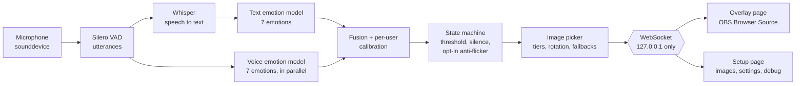

# Emotion Overlay

Listens to your microphone, works out the emotion in what you're saying, and shows an image you picked for that emotion. Built for streamers and PNGTubers: add one URL to OBS as a Browser Source, and your on-screen image reacts to you with no webcam and no hotkeys.

Everything runs locally. Audio never leaves your machine.

> **Status:** feature-complete (phases 1–4 of [SPEC.md](SPEC.md)), with measured accuracy and latency below. Built as a portfolio project: the README covers design decisions, [privacy](#privacy), [security](#security) and [honest results](#evaluation).

## Features

- **Words and tone of voice:** a text model reads what you say, and a second model listens to how you say it. Their scores are combined with a weight you control.
- **Calibration that adapts to you:** read 14 short lines. The app learns how your voice and mic sound, profiles how you speak (pauses, volume vs. background, expressiveness), tests whether tone of voice helps for you, and recommends settings tuned to you, each with its reason. You choose which to apply.
- **Your images and GIFs:** several per emotion, chosen at random or in a cycle, with optional **Mild** and **Strong** versions picked by how confident the detection is. Add files, paste a link (direct, Tenor or Giphy), or drag a GIF in from another browser tab. GIFs restart from their first frame every time they appear.
- **Word triggers:** say "gg" or "let's go" and a chosen image or GIF shows for a few seconds, then the emotion image comes back. Matching is whole-word and ignores case; each trigger can list alternative spellings and has a Test button for checking it in OBS.
- **Slang:** triggers forgive how Whisper spells things ("sup" fires on "Wassup", "bruh" on "Bruhhhh", "lol" on "L-O-L"), and slang is read as plain English before emotion scoring ("lol" counts as "haha", "that was fire" as "that was amazing"). The text model was trained on ordinary English and otherwise reads "lol" as neutral and "no cap that was fire" as anger. The table lives in `src/emotion_overlay/slang.py`; ambiguous words ("bet", "goat") are left out on purpose.
- **Transitions:** cross-fade, cut, or bounce.
- **CPU or GPU:** choose where the models run on the setup page. Switching takes effect without a restart. GPU support is an optional install (see [NVIDIA GPU](#nvidia-gpu-optional-much-faster)).
- **Live settings:** every display and detection setting can be changed on the setup page while you're streaming. Changes apply immediately and are saved.
- **Hold an emotion by hand:** buttons on the setup page, or global hotkeys that work while a game has focus: **Ctrl+Alt+Shift + 1–7** holds anger, disgust, fear, joy, neutral, sadness or surprise, and **+ 0** (or the same key again) goes back to automatic. A Stream Deck can do the same with `PUT /api/manual {"emotion": "joy"}`. Hotkeys use Windows' `RegisterHotKey`, so the app only ever sees those exact key combinations, never anything else you type. The modifiers are set in `config.yaml` (`hotkeys.modifiers`).
- **Responsive by default:** the image follows every sentence, and can change while you're still talking: during long sentences the words so far are re-checked every second of speech (**Update while talking**; 0 turns it off). Optional anti-flicker controls (smoothing, a hold-off before switching, minimum time on screen) are available if you want a calmer overlay.
- **Your mic is remembered by name,** so plugging in a headset or a webcam doesn't switch the app to the wrong input. If the saved mic isn't connected, the setup page says so and the system default is used until it's back.
- **Stop/Start listening:** one button on the setup page. Pausing closes the microphone completely, so Windows' mic-in-use indicator goes off. Speech still being processed is thrown away, and the overlay shows your neutral image.
- **Backup:** export your whole setup (images and settings) as a zip, and import it on another PC or share it.

## How it works



Everything in this diagram runs on your PC. The overlay only ever receives "show this image"; transcripts and scores go only to the setup page.

- **Voice activity detection** ([Silero VAD](https://github.com/snakers4/silero-vad)) splits audio into utterances. One ends after a 400 ms pause. Long speech is cut every 6 s so the image still updates mid-rant.
- **Speech-to-text:** Whisper `base.en` via [faster-whisper](https://github.com/SYSTRAN/faster-whisper), or via 🤗 transformers when faster-whisper can't load (see [Windows notes](#windows-notes)).
- **Emotion:** [`j-hartmann/emotion-english-distilroberta-base`](https://huggingface.co/j-hartmann/emotion-english-distilroberta-base) scores the last ~6 s of transcript. The 7 labels are anger, disgust, fear, joy, neutral, sadness and surprise.
- **Tone of voice:** [`tiantiaf/wavlm-large-categorical-emotion`](https://huggingface.co/tiantiaf/wavlm-large-categorical-emotion) from [Vox-Profile](https://arxiv.org/abs/2505.14648) (OpenRAIL licence), a WavLM-large model trained on MSP-Podcast, i.e. natural podcast speech rather than actors. It's a simplified, audio-only version of the top system in the INTERSPEECH 2025 speech emotion challenge. It knows all 7 emotions plus "contempt" and "other". It was published for the authors' own wrapper class rather than as a transformers model, so `classify/vox_profile.py` rebuilds its small inference path (stock WavLM encoder, learned mix of its layers, a pooled classifier) and loads the weights directly. It runs on the same audio at the same time as Whisper. If it's still busy when the words are scored, the words-only result is shown first and refined when the voice is done, so it never delays the first reaction.
- **Why this model:** it replaced `superb/hubert-base-superb-er` (IEMOCAP, 4 moods), which answered "angry" for 79% of RAVDESS clips. On RAVDESS the new one triples voice-only macro-F1 (see [Evaluation](#evaluation)). I ruled out models trained on RAVDESS (they would invalidate the evaluation) and a larger IEMOCAP model (`superb/hubert-large-superb-er`), which was no better than the base one.
- **Label mapping, explicit:** voice labels never leak past the fusion step. A configurable `label_map` says which emotions each voice label stands for. For 4-mood models one label can cover several (e.g. `ang → anger, disgust, fear`); its probability is then shared in proportion to the text scores, so the voice says *agitated* and the words say *which kind*. Labels with no image group ("contempt", "other") are ignored. When no words were heard (a laugh, a gasp), the voice alone decides.
- **Late fusion:** `final = (1 − w) · text + w · voice`, with `w = 0.25` by default (adjustable live).
- **Calibration** (`calibration.py`): fits two small sets of per-class log-space offsets, `softmax(log p + b)`. The first undoes a skew in the voice model for your mic, for example "everything sounds angry". The second nudges the combined result. They're L2-regularised, clipped at ±3, and left at 0 for emotions you didn't record. The reported "after" accuracy is **leave-one-out**: each line is scored by a fit that never saw it.
- **Personalised settings** (`personalize.py`): the same 14 lines also tune settings to the speaker. During calibration a line only ends after 900 ms of quiet, so it isn't split and the pauses inside it can be measured. Every rule needs enough evidence and stays within safe bounds.

  | Measured | Setting | Rule |
  |---|---|---|
  | Pauses inside your lines | Pause that ends a sentence | Your typical (75th-percentile) pause + 100 ms, between 300 and 700 ms. It's biased toward fast reactions, because a split sentence still gets judged as a whole via the rolling text window |
  | VAD score of your speech vs. your background | Voice detection threshold | Moved only if your speech or your background comes close to the current threshold (a quiet speaker or a noisy room) |
  | Leave-one-out accuracy at voice weights 0–0.8 | Voice weight, or tone of voice off | Changes only if it gets at least one more line right than the current weight. Among ties it picks the smallest change, and it only turns voice off if every weight does worse than none |
  | Scores of your correctly detected emotional lines | Minimum confidence | The highest threshold that still lets 85% of them through |
  | Same scores | Strong-tier threshold | Their median, so your Mild and Strong images show about equally often |
- **State machine** (`state_machine.py`): pure, unit-tested logic that decides what is actually displayed. Models never drive the image directly. The rules:

  ```
  raw scores -> EMA smoothing -> candidate (top score)
  switch when: candidate >= confidence threshold
           AND (on top for N windows OR leads by a margin)
           AND current emotion shown for >= min display time
  silence for T seconds -> neutral
  ```

  Smoothing, N, the margin and the minimum display time all default to "off". That was a deliberate product choice: the image should react to every sentence. They're unit-tested both on and off, including a noisy-monologue test that shows they suppress single-sentence spikes.
- **Server:** FastAPI on `127.0.0.1:8765`, which serves the pages, the REST API for images and settings, and a WebSocket event stream.

## Install

No prebuilt installer is published. It isn't code-signed, and Windows (Smart App Control in particular) blocks unsigned apps, so run from source. The installer can still be built yourself (see [Building the Windows installer](#building-the-windows-installer)).

### From source

You need Python 3.11+ on Windows, macOS or Linux, and [uv](https://docs.astral.sh/uv/) (recommended) or pip.

```sh
uv sync                      # or: pip install -r requirements.txt
```

### NVIDIA GPU (optional, much faster)

The default install uses the CPU-only build of PyTorch. To run the models on an NVIDIA GPU (Windows or Linux), install the CUDA build instead. It's about 3 GB:

On Windows the easiest way is the two launchers in the repo folder. They can be used side by side:

| | Start with | Environment |
|---|---|---|
| CPU | `run-cpu.bat` | `.venv` in the repo folder |
| GPU | `run-gpu.bat` | `%LOCALAPPDATA%\emotion-overlay\gpu-venv`, kept apart because it's ~3 GB (the first run installs it) |

Both use the same `config.yaml`, images and calibration. Elsewhere, or by hand:

```sh
uv sync --extra gpu                              # or, with pip: pip install torch --index-url https://download.pytorch.org/whl/cu130
uv run --extra gpu python -m emotion_overlay     # keep --extra gpu: a plain `uv run` puts the CPU build back
```

Then choose **Processor → GPU** (or **Automatic**) on the setup page. The switch happens while the app runs: the current models keep working until the new ones have loaded. The page shows which GPU was found and where each model is running. faster-whisper needs CUDA 12 libraries that the CUDA 13 PyTorch build doesn't include, so speech-to-text normally runs on the GPU through PyTorch instead, with the same no-speech filter. On an RTX 5070, processing went from about 810 ms per sentence on the CPU to about 90 ms (speech-to-text ~90 ms and voice ~50 ms in parallel), using about 1.9 GB of video memory. Set Processor to **Automatic** if you use both launchers: each then uses what it has.

## Run

```sh
uv run python -m emotion_overlay      # or: python -m emotion_overlay
```

The first start downloads the models (~1.8 GB, one time; 1.3 GB of it is the tone-of-voice model). After that, startup is offline.

1. Open **http://127.0.0.1:8765/setup**.
2. Pick your microphone and click **Use this mic**.
3. Add images for each emotion. Click ★ on one to make it the default, which is shown for emotions that have no images of their own. Optionally set an image's tier to **Mild** or **Strong**.
4. Talk. The **Live** panel shows what was heard, the emotion scores and timings.
5. Adjust things in **Settings** while you talk. Changes apply immediately.

### Add to OBS

1. **Sources → + → Browser**.
2. URL: `http://127.0.0.1:8765/overlay`. Width and height: your image size (e.g. 800 × 800).
3. Leave custom CSS empty. The page background is already transparent.

URL options: `?fit=cover` fills the source and crops instead of letterboxing. `?label=1` shows the emotion name, which helps when testing.

### Options

| Flag | Purpose |
|---|---|
| `--config PATH` | Config file (default `config.yaml`; every key is optional). See [`config.example.yaml`](config.example.yaml). |
| `--no-audio` | Serve the web UI without loading models or opening the mic. |
| `--open-browser` / `--no-open-browser` | Open the setup page on start (on by default only in the installed app). |
| `--self-test` | Load every model, run each once without a microphone, then exit. |
| `--log-level DEBUG` | Verbose logs, including any HTTP requests (useful to verify the privacy claims below). |

## Evaluation

### RAVDESS (public dataset)

[RAVDESS](https://zenodo.org/records/1188976) has 1,440 speech clips from 24 actors. **Every clip is one of two emotionally neutral sentences** ("Kids are talking by the door"), each said in 8 emotions, so it isolates how much the *voice* model contributes. "Calm" is mapped to neutral. The full report, with per-emotion precision/recall/F1, confusion matrices and breakdowns, is in [`eval/results/ravdess/report.md`](eval/results/ravdess/report.md).

| Mode | Accuracy | Macro-F1 |
|---|---|---|
| Always say "neutral" (majority baseline) | 20.0% | — |
| Words only | 21.9% | 7.9% |
| Voice only | **40.1%** | **35.5%** |
| Combined, app default (voice weight 0.25) | 22.5% | 9.0% |
| Combined, voice weight chosen on other speakers (1.0) | 40.1% | 35.5% |
| Combined + per-speaker calibration (weight 0.25) | 25.8% | 13.1% |
| *Previous voice model (`superb/hubert-base-superb-er`), voice only* | *21.4%* | *11.9%* |

Chance is 14.3% across 7 emotions. What the numbers show:

- **The words carry nothing here, by design.** The text model says "neutral" for almost every clip, so it barely beats the majority baseline. One small signal leaks through: when Whisper hears a rising voice it writes a "?", and the text model reads that as surprise.
- **The voice model transfers to unseen actors.** Trained only on podcast speech, it still gets 40% across 7 emotions on RAVDESS, nearly double the previous model (21%), and its macro-F1 is three times higher. The previous model answered "ang" for 79% of clips. This one is best at anger (79% recall), fear (70%), neutral (48%) and surprise (38%). It mostly misses acted joy (7%) and disgust (2%), which it hears as fear or anger.
- **At the default weight, the words dominate.** At 0.25, a confident "neutral" from the words outweighs the voice, so the combined score barely moves on this dataset. On these neutral sentences the best weight is all voice (both speaker splits chose 1.0). The app still defaults to 0.25, because in real use the words usually do carry the emotion (79% words-only in the developer's own calibration). Calibration measures this for your voice and recommends a weight.
- **Calibration helps the voice most.** Fitting on 2 clips per emotion per speaker and testing on the rest takes the voice model alone from 40% to 44%. The combined score gains less at weight 0.25, for the reason above.
- **Acted datasets overestimate real-world accuracy.** Actors exaggerate emotions far more than streamers talking naturally do. The new model was trained on natural speech, so it should suit streaming better than acted benchmarks suggest, but that's untested until it's measured on real recordings (`eval record`).

### Latency

Measured from the end of speech to a new emotion being decided, over all 1,440 clips. Hardware: Ryzen (AMD Family 25), 16 threads, CPU only, faster-whisper `base.en`.

| | Median | p90 | p95 | Max |
|---|---|---|---|---|
| First reaction (words) | 817 ms | 830 ms | 835 ms | 1,140 ms |
| Words + voice | 1,255 ms | 1,413 ms | 1,473 ms | 1,770 ms |

Both are under the 2-second target. The first reaction is the 400 ms pause that ends a sentence, plus speech-to-text (394 ms) and the text model (22 ms). The voice model (855 ms on CPU while Whisper runs) is slower than speech-to-text, so the app shows the words-only result first and refines it when the voice is done. During long sentences, **Update while talking** reacts before the pause. The overlay's fade (300 ms by default) comes on top. With the transformers fallback for Whisper, add roughly 0.1–0.9 s.

### Reproduce

```sh
uv run python -m emotion_overlay.eval download ravdess          # 208 MB, checksum-verified
uv run python -m emotion_overlay.eval --config config.example.yaml run ravdess   # ~20 min on CPU
```

Raw model outputs are cached in `predictions.jsonl` (not committed), so `... eval report ravdess` re-analyses them in seconds. RAVDESS is © Livingstone & Russo 2018 under CC BY-NC-SA 4.0; its audio is downloaded on demand and never committed.

To test with **your own voice**, run `uv run python -m emotion_overlay.eval record`. It prompts 28 lines: for each emotion, two whose words are emotional and two neutral sentences said with the emotion. Then run `... eval run mine`. The report breaks the results down by line type, which shows directly when the words help and when only the voice can. The recordings stay in `data/recordings/` on your machine.

## Privacy

- **Audio stays in memory.** Utterances are processed and discarded. Nothing is written to disk unless you turn on `debug.save_audio` or `debug.save_transcripts`.
- **Transcripts aren't logged** at the default log level. Only timings and the detected emotion are.
- **No network after first run**, except when you add an image from a link (then only that link is fetched). Models load from the local cache first, and the Hub is contacted only if a model is missing. Telemetry and transformers' background "safetensors conversion" lookups are disabled. To check, run with `--log-level DEBUG` and look for HTTP requests (there are none).
- **Hotkeys don't watch your keyboard.** They're registered with Windows' `RegisterHotKey`, which only reports the app's own key combinations. There's no keyboard hook. Turn them off with `hotkeys.enabled: false`.
- **The overlay never receives transcripts.** Only the setup page subscribes to debug data.
- **Calibration keeps only numbers.** `data/calibration.json` holds the fitted offsets and accuracy figures, not your recordings or words. It's also left out of setup exports, because it's tuned to your voice.

## Security

The server binds to `127.0.0.1`, so other computers can't reach it. Web pages open in your own browser can still send requests to localhost, so the server also defends against that:

| Threat | Mitigation |
|---|---|
| A website reads your live transcript over the WebSocket (cross-site WebSocket hijacking) | WebSocket connections from any other `Origin` are refused |
| A website uploads, deletes or changes settings (CSRF) | `POST`/`PUT`/`DELETE` from another origin get 403 |
| DNS rebinding | Requests with a `Host` header other than localhost get 400 |
| Malicious upload (script, SVG, polyglot, decompression bomb) | Type is decided by parsing the content with Pillow, limited to PNG/JPEG/WebP/GIF. Size limit 10 MB, pixel limit 4096². Served with a fixed MIME type and `nosniff` |
| Path traversal via filename or ID | Files are stored under random IDs. Client filenames are display-only. IDs are regex-validated and looked up in the manifest, never used as paths |
| XSS via filenames or transcripts | The frontend never uses `innerHTML`. A strict CSP allows `'self'` scripts only |
| A shared setup zip that's malicious (zip slip, zip bomb, disguised files) | Nothing is extracted by its zip path. Only the manifest, the settings and `images/<hex id>.<ext>` entries are read, into memory. Entry count, per-file size and total size are capped by bytes actually read. Every image is re-validated like an upload. All of it is checked before anything is changed |
| Server-side request forgery via "add from link" (making the app fetch `http://192.168.1.1/…`, `localhost`, or cloud metadata at `169.254.169.254`) | Only http/https, no credentials in the URL, no unusual low ports. The hostname must resolve to **public** addresses only, and this is re-checked on every redirect. No system proxy. Size is capped by bytes read, and the result goes through the same image validation as an upload. Remaining limit: a DNS answer that changes between the check and the connection |
| A shared setup that changes risky settings | Imports only apply display and detection settings. Server address, debug recording, models and limits in the file are ignored. The settings API rejects them outright |

## Windows notes

**Smart App Control** can block CTranslate2's native library, which faster-whisper depends on. On the development machine it was blocked at first and allowed later, presumably once the file had built up reputation. Instead of asking you to turn off an OS security feature, `asr.backend: auto` detects a block and falls back to running Whisper through transformers/PyTorch, which Windows allows. That fallback measured 0.4–1.2 s per utterance on CPU, against roughly 0.3 s for faster-whisper. The setup page shows which backend is active.

## Development

```sh
uv run python -m pytest     # tests
uv run ruff check .         # lint
uv run ruff format .        # format
```

`uv run pytest` may be blocked by Smart App Control (it launches an unsigned `.exe`). `python -m pytest` works.

### Building the Windows installer

The [Windows installer workflow](.github/workflows/windows-installer.yml) runs on pushes that change `packaging/` and on demand. It only checks that the installer builds and works; nothing is uploaded or published. It builds the app with PyInstaller (`packaging/emotion_overlay.spec`), self-tests the bundle with both Whisper backends, checks the web UI is served, builds the installer with Inno Setup (`packaging/installer.iss`), then installs, self-tests and uninstalls it.

To build locally: `uv sync --group build`, then `uv run python -m PyInstaller packaging/emotion_overlay.spec`, then `iscc /DAppVersion=0.1.0 packaging\installer.iss`. The output goes to `dist/`. A locally built exe is unsigned, so Smart App Control blocks it on the machine that built it.

## Known limitations

- **The voice model is big:** a 1.3 GB download, and about 0.9 s per sentence on CPU while Whisper runs. A GPU makes it much faster (see [NVIDIA GPU](#nvidia-gpu-optional-much-faster)). On RAVDESS it rarely recognises acted joy or disgust (see [Evaluation](#evaluation)), so for those the words do the work. Any transformers audio-classification model can be swapped in with `audio_emotion.model` and `label_map`.
- **Calibration is small:** 14 lines can only nudge the models, not retrain them, and the recommended settings are only as good as how naturally you read the lines. It's fitted at the recommended (or current) voice weight, so recalibrate if you change that weight a lot.
- **English only** for now. The language is a config value, not hard-coded, but the default emotion model is English.
- **Microphone by index:** if you plug in or remove audio devices, re-select your mic on the setup page.
