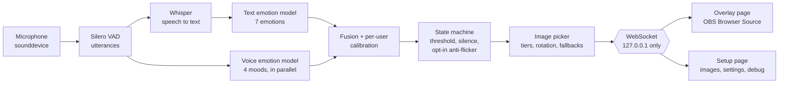

# Emotion Overlay

Listens to your microphone, works out the emotion in what you're saying, and shows an image you picked for that emotion. Built for streamers and PNGTubers: add one URL to OBS as a Browser Source, and your on-screen image reacts to you with no webcam and no hotkeys.

Everything runs locally. Audio never leaves your machine.

> **Status:** feature-complete (phases 1–4 of [SPEC.md](SPEC.md)), with measured accuracy and latency below. Built as a portfolio project: the README covers design decisions, [privacy](#privacy), [security](#security) and [honest results](#evaluation).

## Features

- **Words and tone of voice:** a text model reads what you say, and a second model listens to how you say it. Their scores are combined with a weight you control.
- **Per-user calibration:** read 14 short lines and the app learns how your voice and mic sound. It reports honestly how much that helped.
- **Your images:** several per emotion, chosen at random or in a cycle, with optional **Mild** and **Strong** versions picked by how confident the detection is. Animated GIFs work.
- **Transitions:** cross-fade, cut, or bounce.
- **Live settings:** every display and detection setting can be changed on the setup page while you're streaming. Changes apply immediately and are saved.
- **Responsive by default:** the image follows every sentence. Optional anti-flicker controls (smoothing, a hold-off before switching, minimum time on screen) are available if you want a calmer overlay.
- **Stop/Start listening:** one button on the setup page. Pausing closes the microphone completely, so Windows' mic-in-use indicator goes off. Speech still being processed is thrown away, and the overlay shows your neutral image.
- **Backup:** export your whole setup (images and settings) as a zip, and import it on another PC or share it.

## How it works



Everything in this diagram runs on your PC. The overlay only ever receives "show this image"; transcripts and scores go only to the setup page.

- **Voice activity detection** ([Silero VAD](https://github.com/snakers4/silero-vad)) splits audio into utterances. One ends after a 400 ms pause. Long speech is cut every 6 s so the image still updates mid-rant.
- **Speech-to-text:** Whisper `base.en` via [faster-whisper](https://github.com/SYSTRAN/faster-whisper), or via 🤗 transformers when faster-whisper can't load (see [Windows notes](#windows-notes)).
- **Emotion:** [`j-hartmann/emotion-english-distilroberta-base`](https://huggingface.co/j-hartmann/emotion-english-distilroberta-base) scores the last ~6 s of transcript. The 7 labels are anger, disgust, fear, joy, neutral, sadness and surprise.
- **Tone of voice:** [`superb/hubert-base-superb-er`](https://huggingface.co/superb/hubert-base-superb-er), Apache-2.0, trained on IEMOCAP. It runs on the same audio at the same time as Whisper, so it doesn't add a stage. I picked it over alternatives because one larger model was trained on RAVDESS (which would invalidate the Phase 4 evaluation), one is non-commercial, and one needs a heavy extra framework.
- **Label mismatch, handled explicitly:** the voice model only knows `neu/hap/ang/sad`. A configurable `label_map` says which emotions each one stands for (e.g. `ang → anger, disgust, fear`). A voice label's probability is shared among its emotions in proportion to the text scores, so the voice says *agitated* and the words say *which kind*. When no words were heard (a laugh, a gasp), the voice alone decides.
- **Late fusion:** `final = (1 − w) · text + w · voice`, with `w = 0.25` by default (adjustable live).
- **Calibration** (`calibration.py`): fits two small sets of per-class log-space offsets, `softmax(log p + b)`. The first undoes a skew in the voice model for your mic, for example "everything sounds angry". The second nudges the combined result. They're L2-regularised, clipped at ±3, and left at 0 for emotions you didn't record. The reported "after" accuracy is **leave-one-out**: each line is scored by a fit that never saw it.
- **State machine** (`state_machine.py`): pure, unit-tested logic that decides what is actually displayed. Models never drive the image directly. The rules:

  ```
  raw scores -> EMA smoothing -> candidate (top score)
  switch when: candidate >= confidence threshold
           AND (on top for N windows OR leads by a margin)
           AND current emotion shown for >= min display time
  silence for T seconds -> neutral
  ```

  Smoothing, N, the margin and the minimum display time all default to "off". That was a deliberate product choice: the image should react to every sentence. They're unit-tested both on and off, including a noisy-monologue test that shows they suppress single-sentence spikes.
- **Server:** FastAPI on `127.0.0.1:8765`, which serves the pages, the REST API for images and settings, and a WebSocket event stream.

## Install

You need Python 3.11+ on Windows, macOS or Linux, and [uv](https://docs.astral.sh/uv/) (recommended) or pip.

```sh
uv sync                      # or: pip install -r requirements.txt
```

## Run

```sh
uv run python -m emotion_overlay      # or: python -m emotion_overlay
```

The first start downloads the models (~400 MB, one time). After that, startup is offline.

1. Open **http://127.0.0.1:8765/setup**.
2. Pick your microphone and click **Use this mic**.
3. Add images for each emotion. Click ★ on one to make it the default, which is shown for emotions that have no images of their own. Optionally set an image's tier to **Mild** or **Strong**.
4. Talk. The **Live** panel shows what was heard, the emotion scores and timings.
5. Adjust things in **Settings** while you talk. Changes apply immediately.

### Add to OBS

1. **Sources → + → Browser**.
2. URL: `http://127.0.0.1:8765/overlay`. Width and height: your image size (e.g. 800 × 800).
3. Leave custom CSS empty. The page background is already transparent.

URL options: `?fit=cover` fills the source and crops instead of letterboxing. `?label=1` shows the emotion name, which helps when testing.

### Options

| Flag | Purpose |
|---|---|
| `--config PATH` | Config file (default `config.yaml`; every key is optional). See [`config.example.yaml`](config.example.yaml). |
| `--no-audio` | Serve the web UI without loading models or opening the mic. |
| `--log-level DEBUG` | Verbose logs, including any HTTP requests (useful to verify the privacy claims below). |

## Evaluation

### RAVDESS (public dataset)

[RAVDESS](https://zenodo.org/records/1188976) has 1,440 speech clips from 24 actors. **Every clip is one of two emotionally neutral sentences** ("Kids are talking by the door"), each said in 8 emotions, so it isolates how much the *voice* model contributes. "Calm" is mapped to neutral. The full report, with per-emotion precision/recall/F1, confusion matrices and breakdowns, is in [`eval/results/ravdess/report.md`](eval/results/ravdess/report.md).

| Mode | Accuracy | Macro-F1 |
|---|---|---|
| Always say "neutral" (majority baseline) | 20.0% | — |
| Words only | 21.9% | 7.9% |
| Voice only | 21.4% | 11.9% |
| Combined, app default (voice weight 0.25) | 22.2% | 8.5% |
| Combined, voice weight 0.6 (chosen on other speakers) | **30.1%** | **17.4%** |
| Combined + per-speaker calibration (weight 0.25) | 25.6% | 12.0% |

Chance is 14.3% across 7 emotions. What the numbers show:

- **The words carry nothing here, by design.** The text model says "neutral" for almost every clip, so it barely beats the majority baseline. One small signal leaks through: when Whisper hears a rising voice it writes a "?", and the text model reads that as surprise. That happened on 16 clips, and 14 of them really were surprise.
- **The voice model doesn't transfer to this dataset.** It scores about 65% on 4-class IEMOCAP, the dataset it was trained on (per the SUPERB benchmark), but here it answers "ang" for 79% of all clips. I ruled out the two likeliest preprocessing causes with experiments on a balanced sample: loudness normalisation made it worse, and a proper anti-aliased resampler changed nothing (30.6% vs 31.2%). This is domain shift between recording setups and actors.
- **Fusion helps only when the voice is weighted heavily.** Raising the voice weight to 0.6 adds about 8 points. That held when the weight was picked on half the speakers and tested on the other half (both splits chose 0.6). The app still defaults to 0.25, because in real use the words usually do carry the emotion. That was 79% words-only vs 36% voice-only in the developer's own 14-line calibration.
- **Calibration helps a little but can't fix domain shift.** Fitting on 2 clips per emotion per speaker and testing on the rest gives +1.7 points accuracy and +3 points macro-F1.
- **Acted datasets overestimate real-world accuracy.** Actors exaggerate emotions far more than streamers talking naturally do. Even on acted speech, an off-the-shelf voice model is weak here, so treat the voice feature as a light nudge, not a detector.

### Latency

Measured from the end of speech to a new emotion being decided, over all 1,440 clips. Hardware: Ryzen (AMD Family 25), 16 threads, CPU only, faster-whisper `base.en`.

| Median | p90 | p95 | Max | Target |
|---|---|---|---|---|
| 712 ms | 840 ms | 868 ms | 1,022 ms | < 2,000 ms |

That's the 400 ms pause that ends a sentence, plus processing: speech-to-text (284 ms) and the voice model (301 ms) in parallel, then the text model (20 ms). The overlay's fade (300 ms by default) comes on top. With the transformers fallback for Whisper, add roughly 0.1–0.9 s.

### Reproduce

```sh
uv run python -m emotion_overlay.eval download ravdess          # 208 MB, checksum-verified
uv run python -m emotion_overlay.eval --config config.example.yaml run ravdess   # ~10 min on CPU
```

Raw model outputs are cached in `predictions.jsonl` (not committed), so `... eval report ravdess` re-analyses them in seconds. RAVDESS is © Livingstone & Russo 2018 under CC BY-NC-SA 4.0; its audio is downloaded on demand and never committed.

To test with **your own voice**, run `uv run python -m emotion_overlay.eval record`. It prompts 28 lines: for each emotion, two whose words are emotional and two neutral sentences said with the emotion. Then run `... eval run mine`. The report breaks the results down by line type, which shows directly when the words help and when only the voice can. The recordings stay in `data/recordings/` on your machine.

## Privacy

- **Audio stays in memory.** Utterances are processed and discarded. Nothing is written to disk unless you turn on `debug.save_audio` or `debug.save_transcripts`.
- **Transcripts aren't logged** at the default log level. Only timings and the detected emotion are.
- **No network after first run.** Models load from the local cache first, and the Hub is contacted only if a model is missing. Telemetry and transformers' background "safetensors conversion" lookups are disabled. To check, run with `--log-level DEBUG` and look for HTTP requests (there are none).
- **The overlay never receives transcripts.** Only the setup page subscribes to debug data.
- **Calibration keeps only numbers.** `data/calibration.json` holds the fitted offsets and accuracy figures, not your recordings or words. It's also left out of setup exports, because it's tuned to your voice.

## Security

The server binds to `127.0.0.1`, so other computers can't reach it. Web pages open in your own browser can still send requests to localhost, so the server also defends against that:

| Threat | Mitigation |
|---|---|
| A website reads your live transcript over the WebSocket (cross-site WebSocket hijacking) | WebSocket connections from any other `Origin` are refused |
| A website uploads, deletes or changes settings (CSRF) | `POST`/`PUT`/`DELETE` from another origin get 403 |
| DNS rebinding | Requests with a `Host` header other than localhost get 400 |
| Malicious upload (script, SVG, polyglot, decompression bomb) | Type is decided by parsing the content with Pillow, limited to PNG/JPEG/WebP/GIF. Size limit 10 MB, pixel limit 4096². Served with a fixed MIME type and `nosniff` |
| Path traversal via filename or ID | Files are stored under random IDs. Client filenames are display-only. IDs are regex-validated and looked up in the manifest, never used as paths |
| XSS via filenames or transcripts | The frontend never uses `innerHTML`. A strict CSP allows `'self'` scripts only |
| A shared setup zip that's malicious (zip slip, zip bomb, disguised files) | Nothing is extracted by its zip path. Only the manifest, the settings and `images/<hex id>.<ext>` entries are read, into memory. Entry count, per-file size and total size are capped by bytes actually read. Every image is re-validated like an upload. All of it is checked before anything is changed |
| A shared setup that changes risky settings | Imports only apply display and detection settings. Server address, debug recording, models and limits in the file are ignored. The settings API rejects them outright |

## Windows notes

**Smart App Control** can block CTranslate2's native library, which faster-whisper depends on. On the development machine it was blocked at first and allowed later, presumably once the file had built up reputation. Instead of asking you to turn off an OS security feature, `asr.backend: auto` detects a block and falls back to running Whisper through transformers/PyTorch, which Windows allows. That fallback measured 0.4–1.2 s per utterance on CPU, against roughly 0.3 s for faster-whisper. The setup page shows which backend is active.

## Development

```sh
uv run python -m pytest     # tests
uv run ruff check .         # lint
uv run ruff format .        # format
```

`uv run pytest` may be blocked by Smart App Control (it launches an unsigned `.exe`). `python -m pytest` works.

## Known limitations

- **The voice model is weak outside its training data:** it only knows 4 moods, and on RAVDESS it leans heavily toward "angry" (see [Evaluation](#evaluation)). It's weighted low by default. A stronger or fine-tuned voice model is the clearest next step, and the `audio_emotion.model` and `label_map` settings exist so one can be swapped in.
- **Calibration is small:** 14 lines can only nudge the models, not retrain them. It's fitted at the voice weight in use at the time, so recalibrate if you change that weight a lot.
- **English only** for now. The language is a config value, not hard-coded, but the default emotion model is English.
- **Microphone by index:** if you plug in or remove audio devices, re-select your mic on the setup page.
