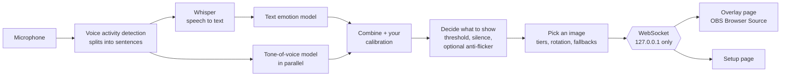

# Emotion Overlay

**Your stream picture reacts to how you sound.** Pick an image for each mood. While you talk, the app works out the emotion in your voice and words, and shows the matching image in OBS. No webcam, no hotkeys needed.

> [!NOTE]
> Everything runs on your own PC. Your audio never leaves it.

| | |
|---|---|
| **Emotions** | anger, disgust, fear, joy, neutral, sadness, surprise |
| **Listens to** | what you say (speech-to-text + a text emotion model) *and* how you say it (a tone-of-voice model) |
| **Speed** | about 0.55 s after you stop talking on an NVIDIA GPU, about 0.8 s on a CPU. Long sentences can update before you pause |
| **Runs on** | Windows and Linux ([Windows guide](INSTALL-Windows.md), [Linux guide](INSTALL-Linux.md)). AMD Radeon GPUs are supported but **not yet tested on a real AMD card** |
| **Extras** | your own images and GIFs, effects, word triggers ("gg", "bruh"), slang, hotkeys, OBS scene and filter switching, calibration to your voice |

**New here?** Start with the [Beginner's guide](#beginners-guide). Everything after it is reference you can dip into when you need it.

<details>
<summary><strong>Contents</strong></summary>

- **Getting started**
  - [Beginner's guide](#beginners-guide)
  - [Make it work better for you](#make-it-work-better-for-you)
  - [Quick fixes](#quick-fixes)
- **Reference**
  - [Features](#features) · [Requirements](#requirements) · [Install from the command line](#install-from-the-command-line)
  - [Add the overlay to OBS](#add-the-overlay-to-obs) · [The setup page](#the-setup-page)
  - [Calibration](#calibration) (quick and long-recording)
  - [Hotkeys and Stream Deck](#hotkeys-and-stream-deck) · [OBS scenes and filters](#obs-scenes-and-filters)
  - [Configuration file](#configuration-file) · [Command-line options](#command-line-options)
  - [How it works](#how-it-works) · [Accuracy and speed](#accuracy-and-speed)
  - [Privacy](#privacy) · [Security](#security)
  - [Troubleshooting](#troubleshooting) · [Known limitations](#known-limitations)
  - [Project layout](#project-layout) · [Credits](#credits) · [License](#license)

</details>

---

## Beginner's guide

No technical knowledge needed. This is written for Windows 10 and 11. On Linux, follow the [Linux installation guide](INSTALL-Linux.md) instead of Steps 1 and 2, then carry on here from Step 3.

**You'll need:**

- A Windows PC and a microphone.
- About **3.5 GB** of free disk space (about 7 GB to use an NVIDIA graphics card, 10 GB or more for an AMD one).
- Internet for the **first start only**: the app downloads its models once (about 2 GB).
- [OBS Studio](https://obsproject.com/) to show the pictures on stream. A browser tab works too.
- A few pictures or GIFs: one or more for each mood.

### Step 1: Download the app

1. At the top of this GitHub page, click the green **Code** button, then **Download ZIP**.
2. Right-click the downloaded file (usually in **Downloads**), choose **Extract All…**, then **Extract**.
3. Move the new folder somewhere you'll find again, like your Desktop.

### Step 2: Start it

> [!TIP]
> Got a gaming graphics card? In step 1, use **`run-gpu.bat`** (NVIDIA) or **`run-amd.bat`** (AMD Radeon RX 7000/9000, not yet tested on a real card) instead. It reacts faster and understands speech better, but the first start downloads several GB more. The [Windows installation guide](INSTALL-Windows.md) helps you choose.

1. Open the folder and double-click **`run-cpu.bat`**.
2. If a blue "Windows protected your PC" box appears, click **More info**, then **Run anyway**.
3. A black window opens with text scrolling by. **The very first start takes several minutes.** Later starts take seconds.
4. When it shows `Setup page: http://127.0.0.1:8765/setup`, go on to Step 3.

> [!IMPORTANT]
> Keep the black window open while you use the app. Closing it turns the app off.

### Step 3: Open the setup page

In your web browser, go to **`127.0.0.1:8765/setup`**. This page controls everything. It only exists on your PC.

The first time, the bar at the top says **Loading…** while the models download. You can already add pictures (Step 5) meanwhile.

### Step 4: Choose your microphone

In the **Microphone** box, pick your mic and click **Use this mic**. Say something: in the **Live** box the dot should light up with **Speaking**, and your words appear under **Last transcript**.

### Step 5: Add your pictures

The **Images** box has a square for each mood.

1. Click **Add** on a square and pick files. You can also drag files onto it, or click **Link** and paste a GIF link (Giphy, Tenor…).
2. Give **Neutral** at least one picture. That's your "normal" face, shown when you're calm or quiet.
3. Click the **★** under your favourite picture to make it the **default**, used for any mood without its own picture.

Start with neutral and joy; add more whenever you like.

### Step 6: Put it on your stream (OBS)

1. In OBS, under **Sources**, click **+** → **Browser**, name it, click **OK**.
2. URL: `http://127.0.0.1:8765/overlay`
3. Set **Width** and **Height** to your pictures' size (for example 800 × 800), click **OK**.
4. Move and resize it like any other source.

The background is see-through. Without OBS, open `127.0.0.1:8765/overlay` in a browser tab.

### Step 7: Talk!

About a second after you finish a sentence, the picture changes. Try "this is amazing, I love it!" for your joy picture. The **Live** box shows what was heard and how sure the app was.

**Next time:** double-click the same launcher and wait for the setup page line. Everything is remembered, and OBS reconnects on its own.

## Make it work better for you

All optional.

| | What it does | Where |
|---|---|---|
| **Calibration** (2 min, recommended) | Read 14 short lines in the mood shown. The app learns your voice and mic and suggests settings | **Calibration** box → **Start** |
| **Long-recording calibration** | Tunes the app to how you *really* sound while playing, from a live session or a past stream's video | **Calibrate from a long recording** box ([details](#long-recording-calibration)) |
| **Word triggers** | Show a picture for a few seconds when you say a word, like "gg" | **Word triggers** box |
| **Hotkeys** | Keys that work in-game. **Ctrl+Alt+Shift+1–7** lock a mood, **+0** goes back to automatic | **Hotkeys** box |
| **Settings** | Fade style, reaction speed and more. **Reset to defaults** undoes everything | **Settings** box |
| **Backup** | Save all pictures and settings in one file | **Backup** box → **Export setup** |

## Quick fixes

| Problem | Try this |
|---|---|
| The picture never changes | Check the **Live** box says **Speaking** when you talk; if not, pick another mic. If the top button says **Start listening**, click it |
| OBS shows nothing | Is the black window still open? Does the mood have a picture (or a ★ default)? In OBS, right-click the source → **Refresh** |
| It picks the wrong mood | Calibrate. If calm talk often shows as sad, try the [long-recording calibration](#long-recording-calibration) |
| "An Application Control policy has blocked this file" | That's Windows' Smart App Control: see [Troubleshooting](#troubleshooting) |
| The black window shows an error and stops | Take a screenshot and check [Troubleshooting](#troubleshooting) |

---

# Reference

## Features

| Feature | Details |
|---|---|
| **Words and tone of voice** | A text model reads what you say, a second model listens to how you say it. They're combined with a weight you control, so a sarcastic "great" or a laugh can count |
| **Your images and GIFs** | Several per emotion, random or in a cycle. Optional **Mild** and **Strong** versions picked by confidence. Add files, paste a link (direct, Tenor or Giphy), or drag a GIF in from another tab. GIFs restart from their first frame each time |
| **Fallbacks** | An emotion with no images can borrow another emotion's, or show your default image |
| **Word triggers** | Say "gg" or "let's go" and a chosen image shows for a few seconds. Alternative spellings and a **Test** button |
| **Slang** | Triggers forgive speech-to-text spelling ("sup" fires on "Wassup", "bruh" on "Bruhhhh", "lol" on "L-O-L"). Slang is also read as plain English before scoring, so "that was fire" counts as "that was amazing" rather than anger |
| **Updates while you talk** | Long sentences are re-checked as you go (every 0.5 s of speech on a GPU, 1 s on a CPU) |
| **Hotkeys you choose** | Global, work in-game: hold an emotion, show any image (until pressed again or for a few seconds), fire a word trigger, or go back to automatic. Also over HTTP for a Stream Deck |
| **Calibration** | Quick (14 read lines) or from a long recording of you playing. Corrects the models for your voice and mic, and recommends settings with reasons; you choose which to apply |
| **CPU or GPU** | Switch on the setup page while running. GPU support (NVIDIA, or AMD, untested) is an optional install |
| **Live settings** | Every display and detection setting changes instantly and is saved |
| **Responsive by default** | The image follows every sentence. Optional anti-flicker controls calm it down |
| **Transitions and effects** | Cross-fade, cut or bounce, plus a per-emotion effect: shake, pulse, jump, tremble or droop |
| **OBS scenes and filters** | The emotion can switch OBS scenes or turn filters on, via OBS's built-in WebSocket server |
| **Mic remembered by name** | Plugging in a headset or webcam doesn't switch the app to the wrong input |
| **Stop/Start listening** | Pausing closes the mic completely (your system's mic indicator goes off) and shows neutral |
| **Backup** | Export images, triggers and settings as one zip; import on another PC |

## Requirements

| | |
|---|---|
| **System** | Windows 10/11, or 64-bit Linux (x86-64). Developed on Windows; CPU and NVIDIA tested on Ubuntu 26.04, where everything except global hotkeys works. macOS untested |
| **Microphone** | A dedicated input works best. "Stereo Mix" or desktop-audio devices pick up game sound too |
| **Disk space** | About 3.5 GB; about 7 GB with NVIDIA support, 10 GB or more with AMD. Mostly the models, downloaded on first start |
| **Graphics card** (optional) | Faster, and a more accurate speech model. About 4 GB of video memory is enough |
| ↳ NVIDIA | GTX 10 series or newer, driver 580 or newer |
| ↳ AMD | Radeon RX 7000/9000. Windows needs Adrenalin 26.2.2 or newer; on Linux any GPU ROCm 7.2 supports. **Not yet tested on AMD hardware** |

Python 3.11+ and [uv](https://docs.astral.sh/uv/) are used, but you don't need to install them first: the Windows launchers install uv, and uv installs Python.

## Install from the command line

Step-by-step guides, including updating and uninstalling: **[Windows](INSTALL-Windows.md)** (double-click a launcher) and **[Linux](INSTALL-Linux.md)** (PortAudio, uv, then `uv sync`).

With [uv](https://docs.astral.sh/uv/getting-started/installation/) installed, in the app's folder:

```sh
uv sync && uv run python -m emotion_overlay                               # CPU (Windows)
uv sync --extra cpu && uv run --extra cpu python -m emotion_overlay       # CPU (Linux)
uv sync --extra gpu && uv run --extra gpu python -m emotion_overlay       # NVIDIA GPU
uv sync --extra amd && uv run --extra amd python -m emotion_overlay       # AMD GPU, Linux only (untested)
```

> [!WARNING]
> Keep the same `--extra` option on every `uv run`, or uv swaps in a different build of PyTorch. On Linux a plain `uv sync` installs PyPI's PyTorch, which bundles NVIDIA's libraries (about 4 GB more), so use `--extra cpu` there.

The first start downloads about 2 GB of models, plus about 1.6 GB for the larger speech model (`large-v3-turbo`) the first time a GPU is used. After that the app starts offline.

**Quick start once it's running:** open **http://127.0.0.1:8765/setup** → pick your mic → **Processor: Automatic** → add images (★ one as default) → calibrate → add the overlay to OBS and talk. The **Live** panel shows what was heard, the scores and the timings.

## Add the overlay to OBS

1. **Sources → + → Browser**.
2. URL: `http://127.0.0.1:8765/overlay`. Width and height: your image size (for example 800 × 800).
3. Leave custom CSS empty; the background is already transparent.

| URL option | Effect |
|---|---|
| `?fit=cover` | Fill the source and crop, instead of fitting the whole image with borders |
| `?label=1` | Show the emotion's name (handy for testing) |

Combine with `&`: `http://127.0.0.1:8765/overlay?fit=cover&label=1`. The overlay only ever receives "show this image"; transcripts and scores never reach it.

## The setup page

**http://127.0.0.1:8765/setup**. Everything on it applies immediately and is saved.

<details open>
<summary><strong>Microphone, Processor, Live</strong></summary>

- **Microphone:** pick an input and click **Use this mic**. It's remembered by name and audio system, so plugging devices in or out doesn't change it. If it isn't connected, the page says so and the system default is used until it's back. **Stop listening** (top of the page) turns the mic off completely.
- **Processor:** **Automatic (GPU if available)**, **GPU** or **CPU**. GPU means NVIDIA, or AMD when started with `run-amd.bat` / `--extra amd` (untested). The card shows which GPU was found (or why it can't be used) and where each model runs. Switching loads the models on the new device in the background while the current ones keep working. Not possible in the first seconds after starting, while models load.
- **Live:** current emotion and image, whether you're speaking, the last transcript, the text the emotion model read, scores per emotion, the tone-of-voice result and timings. **Hold an emotion** keeps one on screen until you click **Automatic**; detection keeps running underneath. Word triggers still show over a held emotion.

</details>

<details open>
<summary><strong>Images and word triggers</strong></summary>

- **Images:** PNG, JPEG, WebP or GIF, up to 10 MB and 4096 × 4096 pixels each. Upload, paste a link (Tenor/Giphy pages work) or drag one in from another tab.
  - Each image belongs to an emotion, or to the **trigger** group (used only by word triggers).
  - **Tier:** **Any**, **Mild** or **Strong**. Strong shows at or above the Strong-tier threshold, Mild below. Without the needed tier, **Any** images are used, then whatever the emotion has.
  - **★ Default** is shown for emotions without images. Names are only for you; files are stored under random IDs.
- **Word triggers:** one or more phrases, an image and a duration (0.5–60 s). Matching is whole-word and ignores case, punctuation and apostrophes ("G.G." matches "gg"). Stretched letters ("bruhhhh") and common slang spellings match too. Up to 50. **Test** shows one without saying it.

</details>

### Settings

| Setting | Default | What it does |
|---|---|---|
| **Display** | | |
| Transition | Cross-fade | Cross-fade, cut or bounce between images |
| Transition time | 300 ms | Length of the transition |
| With several images | Pick randomly | Random (never the same twice in a row) or cycle in order |
| New image every sentence | Off | Switch to another image of the same emotion each time you speak |
| Strong-tier threshold | 0.85 | Strong images show at or above this confidence |
| **Detection** | | |
| Minimum confidence | 0.5 | Below this, the detection counts as unsure |
| When unsure | Keep current image | Keep the current image, or go to neutral |
| Back to neutral after silence | 3 s | Show neutral after this much silence |
| Text window | 6 s | How much recent speech is judged together. 0 = only the last sentence |
| Update while talking | Automatic | Re-check while you're still talking: every 0.5 s on a GPU, 1 s on a CPU, a fixed interval, or off |
| Understand slang | On | Read slang as plain English before judging the emotion |
| Pause that ends a sentence | 400 ms | Shorter reacts faster but may split sentences |
| Longest chunk of speech | 6 s | Non-stop talking is judged in chunks this long |
| Voice detection threshold | 0.5 | Higher ignores more background noise |
| **Tone of voice** | | |
| Use tone of voice | On | Turn the voice model on or off |
| Voice weight | 0.25 | How much the voice counts against the words. 0 = words only, 1 = voice only |
| **Stability (anti-flicker)** | | All off by default, so the image follows every sentence |
| Smoothing | 1 (off) | Lower values average each new result with the previous ones |
| Sentences before switching | 1 (off) | A new emotion must stay on top this many times in a row |
| Instant-switch lead | 0 (off) | A new emotion that leads by this much switches at once anyway |
| Minimum time on screen | 0 s (off) | Keep each emotion at least this long |
| **Emotions without images** | Default image | Per emotion: the default image, or another emotion's images |
| **Effects** | None | Per emotion: shake, pulse, jump, tremble or droop when its image appears |

**Reset to defaults** restores all of these. Mic, images, triggers and calibration aren't affected.

> [!TIP]
> Set the voice weight high only if calibration recommends it. A high weight lets the tone-of-voice model overrule your words, and it can mistake calm, low-energy talk for sadness.

### Backup

**Export setup** saves images, word triggers and the Settings card as one zip. **Import setup…** checks a zip completely, then **replaces** everything with its contents. Calibration, hotkeys and OBS settings aren't included: they belong to one voice, mic and PC.

## Calibration

Two ways to tune the app to you. Both end the same way: a result showing how often the app was right before and after, and recommended settings, each with its reason, that you tick to apply. Saving one replaces the previous calibration, whichever kind it was.

| | Quick calibration | Long-recording calibration |
|---|---|---|
| **You do** | Read 14 lines aloud, 2 per emotion | Play as usual, or pick a past stream's video. Then check some of the app's guesses |
| **Takes** | About 2 minutes | 15–30 minutes of play (or a file), plus a few minutes checking |
| **Learns from** | Acted speech | How you really sound while playing |
| **Best for** | A first setup; a new mic or room | Calm talk shown as sad (or any other one-sided mistake); fine-tuning |

Recalibrate after changing mics, rooms or the voice model. A calibration made for a different voice model is switched off automatically.

### Quick calibration

Click **Start calibration** and read each line the way it asks ("Say it happy", "Say it scared"…). The app then:

- **Corrects the models for your voice and mic,** for example if the voice model hears you as slightly angry all the time.
- **Recommends settings for how you speak:** your pauses (pause that ends a sentence), your speech against background noise (voice detection threshold), whether tone of voice helps you (voice weight), and how confidently your lines were recognised (minimum confidence, Strong-tier threshold).

### Long-recording calibration

People sound different while actually playing: quieter, flatter, faster. Read lines can't show that. In one 40-minute gaming session, the tone-of-voice model labelled **56%** of sentences as sad while the words were sad in **6%**. With a high voice weight, that put the sad image on screen for plain callouts like "we should go help them".

**1. Give it a recording.** In **Calibrate from a long recording**, choose one:

| Option | How |
|---|---|
| **Record while you play** | Click **Start recording**, play or stream as usual for 15–30 minutes, then **Stop and review**. The overlay keeps working the whole time |
| **A video or audio file** | **Choose a file…**: MP4, MKV, MOV, WebM, MP3, WAV and more, up to 8 GB. If it has several audio tracks you pick one |
| **A link** | A *direct* link to a video or audio file (one that downloads when opened). YouTube and Twitch pages don't work: download the file and choose it instead |

The app finds every sentence with the same voice detection it uses live, then transcribes and scores each one. A 40-minute recording takes about a minute on an NVIDIA GPU (RTX 5070), and longer on a CPU.

> [!TIP]
> A recording with only your mic works best. In OBS you can put the mic on its own audio track (tick a separate track for the mic in **Edit → Advanced Audio Properties**, then enable that track under **Settings → Output → Recording**, in Advanced output mode). With a mixed recording, mark your friends' and the game's lines as **Not me**.

**2. Automatic fix.** Over all your sentences, the app compares how often the tone-of-voice model hears each emotion with how often your words express it, and corrects the gap. It tells you what it found, for example *"Your tone of voice sounded like sadness in 56% of your sentences, but your words expressed sadness in 6%. Corrected: now 4%."*

**3. Check its guesses.** Each sentence is listed with its time, a **▶** button to hear it, and the app's guess (dashed outline).

- Click the emotion you really meant, or **Not me** for friends on voice chat, game sound or music. Click again to undo.
- Filter by **Not checked yet**, **Guessed as emotional** or **All sentences**.
- You don't have to check them all. **At least 8** lets the app also test the voice weight and measure accuracy on your real speech; 30 or more is better.

**4. Calibrate.** Click **Calibrate**. The result appears in the **Calibration** box, with accuracy measured on the sentences you checked, each judged by a calibration fitted without it. Tick the recommended settings you want and save. You can keep checking sentences and click **Calibrate** again.

## Hotkeys and Stream Deck

Global hotkeys work while another app (like a game) has focus. Set them up in the **Hotkeys** card; changes apply right away. Windows only.

| | |
|---|---|
| **Keys** | Click a hotkey's keys, then press new ones. Combinations need Ctrl, Alt or Win so they can't block typing. F1–F24, Pause and Scroll Lock also work alone (good for a Stream Deck or macro pad) |
| **Hold an emotion** | Shows that emotion until you press the same keys again or a "Back to automatic" key |
| **Show an image** | Any image, including **Word triggers only** ones, until pressed again or for a few seconds |
| **Fire a word trigger** | As if you'd said its phrase |
| **Back to automatic** | Lets go of a held emotion or image |
| **Test / Reset / Hotkeys on** | Try one without pressing it / restore the defaults / turn them all off or on |
| **Problems** | A hotkey whose image or trigger was deleted, or whose keys another app uses, is marked on the page |

Hotkeys aren't in backups (they stay on this PC). The defaults:

| Keys | Holds |
|---|---|
| Ctrl+Alt+Shift + 1 … 7 | anger, disgust, fear, joy, neutral, sadness, surprise |
| Ctrl+Alt+Shift + 0, or the same key again | back to automatic |

They use three modifiers because on many keyboard layouts Ctrl+Alt acts as AltGr, and AltGr + a digit types a character.

**Stream Deck / HTTP.** Anything that can send HTTP requests can do the same:

```sh
curl -X PUT http://127.0.0.1:8765/api/manual -H "Content-Type: application/json" -d "{\"emotion\": \"joy\"}"
curl -X PUT http://127.0.0.1:8765/api/manual -H "Content-Type: application/json" -d "{\"emotion\": null}"
```

The first holds joy, the second goes back to automatic. `{"image_id": "<id>"}` holds one image (IDs are in `GET /api/images`).

| Request | Effect |
|---|---|
| `PUT /api/listening` with `{"listening": false}` or `true` | Stop or start listening |
| `POST /api/triggers/<id>/test` | Show a word trigger's image |
| `POST /api/hotkeys/<n>/press` | Do what hotkey `n` (from 0, in the setup page's order) does |
| `PUT /api/compute` with `{"device": "auto"}`, `"cuda"` or `"cpu"` | Choose the processor |
| `GET /api/status` | Current emotion, image and engine status |

Requests from web pages on other sites are refused (see [Security](#security)). A Stream Deck isn't a web page, so it works.

## OBS scenes and filters

The emotion can switch OBS scenes and/or turn on filters, through the WebSocket server built into OBS 28+.

1. In OBS: **Tools → WebSocket Server Settings**, tick **Enable WebSocket server**, and click **Show Connect Info** for the port and password.
2. On the setup page, **OBS scenes and filters**: tick **Connect to OBS**, enter the port (usually 4455) and password, **Save**. The status line says when it's connected.
3. Per emotion, pick a scene, or leave it at "Don't switch".
4. Filters: first add them to a source in OBS (for example a **Color Correction** filter called "Angry red" on the overlay source, turned off). Choose that source under **Toggle filters on**, then a filter per emotion. When an emotion shows, its filter turns on and the others on that source turn off.

OBS follows the emotion on screen, including a held one, but not word triggers. Renamed or removed scenes and filters are reported without disconnecting. If OBS isn't running, the app retries every few seconds. The OBS address and password stay in `config.yaml` on your PC: never sent to the setup page, never in backups.

## Configuration file

Settings live in `config.yaml` in the project folder. The setup page writes it, so you rarely need to edit it. Every key is optional. A few things can only be changed here, and need a restart: the models, devices (other than via the Processor card), the server address, upload limits and debug recording.

<details>
<summary><strong>All settings, with their defaults</strong></summary>

```yaml
audio:
  device: null              # input device index (older setting); the name below takes precedence
  device_name: null         # saved microphone, set by "Use this mic"
  device_hostapi: null      # its audio system (e.g. Windows WASAPI, MME)

vad:                        # voice activity detection (Silero VAD)
  threshold: 0.5            # speech probability needed to count as speech (0.05-0.95)
  min_silence_ms: 400       # pause that ends a sentence
  speech_pad_ms: 150        # audio kept before and after speech
  min_utterance_ms: 250     # shorter sounds are ignored
  max_utterance_s: 6.0      # non-stop speech is cut into chunks this long

asr:                        # speech-to-text (Whisper)
  backend: auto             # auto | faster-whisper | transformers
  model: base.en            # used on the CPU; small.en is more accurate but ~3x slower
  gpu_model: large-v3-turbo # used when speech-to-text runs on the GPU
  device: auto              # auto | cuda | cpu; cuda means any GPU, AMD too (the Processor card sets all three)
  compute_type: int8        # faster-whisper precision
  language: en
  beam_size: 1              # higher is slower and slightly more accurate
  no_speech_threshold: 0.6  # drop text Whisper thinks is noise ("you", "Thank you.")

classifier:                 # emotion from the words
  model: j-hartmann/emotion-english-distilroberta-base
  device: auto
  window_seconds: 6.0       # judge the last N seconds of speech together; 0 = last sentence only
  slang: true               # read slang as plain English first
  interim_s: null           # re-check while still talking every N s of speech; 0 = off; null = automatic

audio_emotion:              # emotion from tone of voice
  enabled: true
  model: tiantiaf/wavlm-large-categorical-emotion
  device: auto
  weight: 0.25              # voice share of the combined score; 0 = words only
  label_map:                # voice model label -> emotions it stands for; other labels are ignored
    anger: [anger]
    disgust: [disgust]
    fear: [fear]
    happiness: [joy]
    neutral: [neutral]
    sadness: [sadness]
    surprise: [surprise]

state:                      # what is shown (see "Settings" above)
  confidence_threshold: 0.5
  low_confidence: hold      # hold | neutral
  silence_timeout_s: 3.0
  smoothing: 1.0            # 1 = off
  persist_windows: 1        # 1 = off
  instant_switch_margin: 0.0
  min_display_s: 0.0

display:
  transition: fade          # fade | cut | bounce
  fade_ms: 300
  rotation: random          # random | cycle
  new_image_each_utterance: false
  strong_threshold: 0.85
  fallbacks: {}             # e.g. {disgust: anger}: show anger's images for disgust if it has none
  effects: {}               # e.g. {anger: shake, joy: pulse}; also shake, jump, tremble, droop

uploads:
  max_bytes: 10485760       # 10 MB per image
  max_pixels: 16777216      # 4096 x 4096
  max_import_bytes: 209715200   # 200 MB per backup zip

server:
  host: 127.0.0.1           # keep on localhost; nothing here is meant to be reachable from a network
  port: 8765

hotkeys:                    # Windows only; edited in the Hotkeys card, not in backups
  enabled: true
  bindings:                 # defaults: ctrl+alt+shift + 0 (automatic) and + 1..7 (the emotions)
  - keys: ctrl+alt+shift+0  # modifiers (ctrl, alt, shift, win) then one key, joined with +
    action: auto            # auto, emotion, image or trigger
  - keys: ctrl+alt+shift+1
    action: emotion
    emotion: anger
  # ... + 2..7 for disgust, fear, joy, neutral, sadness, surprise. Other kinds:
  # - keys: f13
  #   action: image
  #   image_id: <id>        # any image; see GET /api/images
  #   duration_s: null      # null = until pressed again, or 0.5-60 seconds
  # - keys: ctrl+alt+g
  #   action: trigger
  #   trigger_id: <id>      # a word trigger; see GET /api/triggers

obs:                        # OBS remote control (see "OBS scenes and filters"); not in backups
  enabled: false
  host: 127.0.0.1
  port: 4455
  password: ""              # stored here only; never sent to the setup page
  scenes: {}                # e.g. {anger: Rage scene}
  filter_source: ""         # source whose filters are toggled
  filters: {}               # e.g. {anger: Angry red}

debug:                      # privacy: both off; nothing is written to disk unless enabled
  save_audio: false         # save each sentence as a WAV in data/debug/
  save_transcripts: false   # append transcripts to data/debug/transcripts.log

data_dir: data              # images, triggers, calibration
```

**Other voice models:** any Hugging Face audio-classification model can be `audio_emotion.model`. Map its labels in `label_map`. One label may stand for several emotions (a 4-mood model might use `ang: [anger, disgust, fear]`); its probability is then shared between them in proportion to the text scores. Each emotion may appear only once.

</details>

## Command-line options

| Option | Purpose |
|---|---|
| `--config PATH` | Use another config file (default `config.yaml`) |
| `--no-audio` | Serve the web pages only: no models, no microphone |
| `--open-browser` / `--no-open-browser` | Open the setup page on start (off by default) |
| `--self-test` | Load every model, run each once without a mic, then exit. A good first check |
| `--log-level DEBUG` | Verbose logs, including transcripts and any network requests |

The Windows launchers pass options on, for example `run-gpu.bat --self-test`.

## How it works



1. **Sentences.** [Silero VAD](https://github.com/snakers4/silero-vad) scores each 32 ms of audio for speech. A sentence ends after a 400 ms pause; non-stop speech is cut every 6 s. While a sentence is going, the part so far is re-checked (words only) every 0.5 s of speech on a GPU, 1 s on a CPU.
2. **Speech-to-text.** Whisper `base.en` via [faster-whisper](https://github.com/SYSTRAN/faster-whisper) on the CPU. On a GPU, the larger and more accurate `large-v3-turbo` (about 110 ms per sentence there, about 5 s on a CPU), through faster-whisper if NVIDIA's CUDA 12 libraries are installed and otherwise 🤗 transformers (always on AMD, and the fallback when Windows blocks faster-whisper). Text Whisper thinks is noise is dropped; otherwise it "hears" words like "you" in silence.
3. **Emotion from the words.** [`j-hartmann/emotion-english-distilroberta-base`](https://huggingface.co/j-hartmann/emotion-english-distilroberta-base) scores the last ~6 s of transcript, after slang is rewritten as plain English.
4. **Emotion from the voice.** [`tiantiaf/wavlm-large-categorical-emotion`](https://huggingface.co/tiantiaf/wavlm-large-categorical-emotion) from [Vox-Profile](https://arxiv.org/abs/2505.14648): WavLM-large trained on MSP-Podcast (natural podcast speech, not actors), a simplified audio-only version of the top system in the INTERSPEECH 2025 speech emotion challenge. It's published for the authors' own code, so `classify/vox_profile.py` rebuilds its inference path and loads the weights directly. It runs alongside Whisper; if it's still busy when the words are scored, the words-only result shows first and is then refined.
5. **Combining.** `final = (1 − w) · words + w · voice`, with `w = 0.25` by default. Calibration adds two small sets of per-emotion corrections in log space: one undoes a skew in the voice model for your voice and mic, one adjusts the combined result. The long-recording calibration's automatic step matches how often the voice model hears each emotion to how often your words express it, cutting an overused emotion by more than it boosts a rare one.
6. **Deciding what to show** (`state_machine.py`, pure and unit-tested). The top emotion shows if it clears the minimum confidence. Silence returns to neutral. Optional anti-flicker rules are off by default.
7. **Showing it.** The image picker applies tiers, rotation and fallbacks; the server sends the result over a WebSocket to the overlay in OBS, which plays the emotion's effect. With OBS control on, OBS switches scene or filters too.

The server is FastAPI on `127.0.0.1:8765`. The web pages are plain JavaScript and CSS, with no build step.

## Accuracy and speed

**In short:** on a GPU it reacts in about 0.55 s and understands speech best. The words carry most of the emotion in normal talk; the voice model helps most with acted or very expressive speech, and calibration tunes the balance for you.

<details>
<summary><strong>Emotion accuracy on acted speech (RAVDESS)</strong></summary>

Evaluated on [RAVDESS](https://zenodo.org/records/1188976): 1,440 clips from 24 actors. **Every clip is one of two emotionally neutral sentences** ("Kids are talking by the door"), each said in 8 emotions ("calm" counts as neutral). That isolates what the *voice* contributes, because the words carry no emotion. Chance is 14.3%.

| Mode | Accuracy | Macro-F1 |
|---|---|---|
| Always say "neutral" | 20.0% | — |
| Words only | 21.9% | 7.9% |
| Voice only | **40.1%** | **35.5%** |
| Combined, default voice weight (0.25) | 22.5% | 9.0% |
| Combined + per-speaker calibration (0.25) | 25.8% | 13.1% |
| *Previous voice model (`superb/hubert-base-superb-er`), voice only* | *21.4%* | *11.9%* |

- **The voice model transfers to unseen actors:** 40% across 7 emotions, nearly double the previous model. Best at anger (79% recall), fear (70%), neutral (48%) and surprise (38%); it mostly misses acted joy (7%) and disgust (2%), where the words do the work.
- **At the default weight, the words dominate.** A confident "neutral" from the words outweighs the voice here, because these sentences are neutral by design. In normal speech the words usually carry the emotion, which is why the default stays at 0.25. Calibration measures this for your voice.
- **Calibration helps the voice most:** fitting on 2 clips per emotion per speaker takes the voice alone from 40% to 44%.
- **Acted speech isn't streaming.** Actors exaggerate far more than people talking naturally, so these numbers say little about accuracy on stream. That depends mostly on the words, and on how the voice model reads your normal speaking voice (see [Long-recording calibration](#long-recording-calibration)).

</details>

<details>
<summary><strong>Speech-to-text accuracy</strong></summary>

The emotion from your words is only as good as the transcript. Share of words each Whisper model got wrong (lower is better), on an RTX 5070 and a 16-thread Ryzen CPU:

| Speech | `base.en`, CPU (CPU default) | `small.en`, CPU | `large-v3-turbo`, GPU (GPU default) |
|---|---|---|---|
| One person reading clearly (28 lines) | 2.0% | 1.0% | 1.0% |
| Indian-accented English ([Svarah](https://huggingface.co/datasets/ai4bharat/Svarah), 1,000 clips, 117 speakers) | 12.7% | 9.9% | 7.4% |
| Unscripted meetings, headset mic ([AMI](https://huggingface.co/datasets/edinburghcstr/ami), 504 clips) | 17.1% | 15.9% | 15.1% |
| The 28 read lines, with 3 people talking 5 dB quieter in the background | 37.0% | 21.0% | 12.5% |
| Meetings, one mic on the table, people talking over each other (AMI, 634 clips) | 41.6% | 36.3% | 34.1% |
| **Time per sentence** | **~0.4 s** | **~1.2 s** | **~0.1 s** |

- **The GPU model is the most accurate and the fastest,** with the biggest gains where it matters on stream: accents and background voices.
- **On a CPU, `small.en` is a middle ground:** about a fifth fewer mistakes than `base.en` with accents and 40% fewer with background voices, for about 0.8 s more per sentence. Set `asr.model: small.en` to use it.
- **Crosstalk is hard for every model.** With background voices as loud as yours, all of them get about half the words or more wrong. A headset or a directional mic helps more than any model.
- **Not every mistake is a real mishearing.** Some are writing styles ("70 %" vs "70%") or errors in the reference transcripts; they affect every model equally.

</details>

<details>
<summary><strong>Speed</strong></summary>

From the end of a sentence to the new emotion being decided. On top come the overlay's transition (300 ms by default) and OBS.

| | Pause that ends a sentence | Speech-to-text | Voice model | Total (median) |
|---|---|---|---|---|
| CPU (16-thread Ryzen) | 400 ms | ~300–400 ms | ~500–850 ms, in parallel | ~0.7–0.8 s first reaction, ~0.8–1.3 s with voice |
| GPU (RTX 5070) | 400 ms | ~110 ms (`large-v3-turbo`) | ~30–50 ms, in parallel | ~0.55 s |

On the CPU the words-only result appears first and the voice result follows; on the GPU both arrive together. On a GPU the models use about 3.5 GB of video memory.

</details>

## Privacy

- **Audio stays in memory.** Sentences are processed and discarded. Nothing is written to disk unless you turn on `debug.save_audio` or `debug.save_transcripts`.
- **Long-recording calibration** keeps its sentences' audio and transcripts in memory only, for the review list, until you discard it, start another or close the app. A file you upload or link is saved to a private temporary folder and deleted as soon as its sound has been analysed.
- **Transcripts aren't logged** at the default log level, only timings and the detected emotion.
- **No network after the first start,** except when you add an image or a recording from a link (only that link is fetched). Models load from the local cache; Hugging Face is contacted only if a model is missing. Telemetry is off. To check, run with `--log-level DEBUG` and look for HTTP requests.
- **Hotkeys don't watch your keyboard.** They use Windows' `RegisterHotKey`, which only reports the app's own combinations. There's no keyboard hook.
- **The overlay never receives transcripts.** Only the setup page gets them.
- **Calibration keeps only numbers.** `data/calibration.json` holds fitted corrections and accuracy figures, not recordings or words. It's left out of backups.
- **OBS control is off unless you turn it on,** and then only talks to the address you enter. Its password stays in `config.yaml`.
- **Your files stay local.** `config.yaml` and `data/` are in the project folder and excluded from git.
- **Installing GPU support downloads from the vendor:** PyTorch from pytorch.org (`run-gpu.bat`, `--extra gpu`, `--extra amd`) or AMD's repo.radeon.com (`run-amd.bat`). Nothing about you is sent.

## Security

The server only listens on `127.0.0.1`, so other computers can't reach it. Web pages in your own browser can still send requests to localhost, so the server also defends against those.

<details>
<summary><strong>Threats and protections</strong></summary>

| Threat | Protection |
|---|---|
| A website reads your live transcript over the WebSocket | WebSocket connections from any other origin are refused |
| A website uploads, deletes or changes settings | `POST`/`PUT`/`DELETE` requests from another origin get 403 |
| DNS rebinding | Requests whose `Host` header isn't localhost get 400 |
| A malicious image upload (script, SVG, polyglot, decompression bomb) | The type is decided by parsing the content with Pillow, limited to PNG/JPEG/WebP/GIF, with size and pixel limits. Served with a fixed type and `nosniff` |
| A malicious recording for calibration | Read only as audio by FFmpeg (through PyAV), capped at 8 GB, stored under a fixed name in a private temporary folder and deleted after analysis |
| Path traversal through a file name or ID | Files are stored under random IDs. Upload file names are display-only. IDs are validated and looked up, never used as paths |
| Script injection through file names or transcripts | The pages never insert HTML from data. A strict Content Security Policy allows only the app's own scripts |
| A malicious backup zip (zip slip, zip bomb, disguised files) | Nothing is extracted by its path in the zip. Only expected entries are read, into memory, with limits on count and size. Every image is re-validated. Everything is checked before anything changes |
| "Add from link" (image or recording) used to reach your network (router, localhost, cloud metadata) | Only http/https to **public** addresses, re-checked on every redirect, with no system proxy. Size-capped |
| A shared setup that changes risky settings | Imports only apply display and detection settings. The server address, OBS connection, debug recording, models and limits are ignored |

</details>

## Troubleshooting

> [!TIP]
> **Run the self-test first.** On Windows: `run-cpu.bat --self-test` (or with `run-gpu.bat` / `run-amd.bat`). Anywhere: `uv run python -m emotion_overlay --self-test`, with the `--extra` you installed with after `uv run`. It loads and runs every model and names the step that fails. The [Windows](INSTALL-Windows.md#windows-problems) and [Linux](INSTALL-Linux.md#linux-problems) guides cover system-specific problems.

<details open>
<summary><strong>Common problems</strong></summary>

**"An Application Control policy has blocked this file" (Smart App Control).** Windows blocks unsigned native libraries without a good reputation yet, and its verdict can change over time.
- If it blocks faster-whisper, the app falls back to Whisper through PyTorch automatically (`asr.backend: auto`). Slower on a CPU, but it works.
- If it blocks PyTorch in one environment, try the other launcher. The GPU environment's PyTorch can also run on the CPU: **Processor → CPU**.
- `uv run pytest` can be blocked too; `uv run python -m pytest` works.

**GPU not available.** The Processor card says why.
- "PyTorch is CPU-only": use `run-gpu.bat` or `run-amd.bat`, or `uv sync --extra gpu` (`--extra amd` on Linux). Keep that `--extra` on every `uv run`.
- "No NVIDIA GPU" / "No AMD GPU supported by ROCm": the driver is missing or too old, or the card isn't supported. See your system's installation guide.

**"The models are still loading"** when switching processor or starting a long-recording calibration: wait until the status says it's listening.

**Setup page doesn't open, or "already running".** Only one copy can run. Close the other console window, or open http://127.0.0.1:8765/setup. If port 8765 is taken, set `server.port` in `config.yaml` and use the new port in OBS too.

**"Your saved mic isn't connected".** Plug it in and click **Refresh list**, or pick another mic.

**It reacts to game audio or background noise.** Use a dedicated mic input rather than desktop audio, raise the voice detection threshold, or calibrate so the app can measure your background noise.

**Calm talk often shows as sad (or another wrong emotion).** Lower the voice weight, or run the [long-recording calibration](#long-recording-calibration), which corrects exactly this.

**It mishears you when others talk nearby.** Use a headset or a close mic. A GPU helps a lot (larger speech model). On a CPU, `asr.model: small.en` is more accurate at about 0.8 s more per sentence.

**The image changes too often.** Turn on a Stability setting, for example "Sentences before switching" = 2 or "Minimum time on screen" = 3 s.

**Hotkeys don't work.** They're Windows only. The setup page marks combinations another app uses; pick different keys. Some (Ctrl+Alt+Delete, many Win + letter keys) are reserved by Windows.

**OBS won't connect.** Check OBS is running, **Enable WebSocket server** is ticked, and the port and password match **Show Connect Info**. "OBS refused the connection" means the password is wrong.

**A link for the long-recording calibration doesn't work.** It must be a direct link to the file itself. Video pages (YouTube, Twitch, a Google Drive preview) are web pages, not files: download the file and use **Choose a file…**.

**The first start is slow.** It downloads about 1.8 GB of models once, plus about 1.6 GB for `large-v3-turbo` the first time the GPU is used.

</details>

## Known limitations

- **English only** by default. The speech-to-text language is a setting, but the default text emotion model is English.
- **The voice model is big:** 1.3 GB, about 0.85 s per sentence on a CPU (about 40 ms on a GPU). It rarely recognises acted joy or disgust; the words do the work there.
- **Quick calibration is small.** 14 lines can only nudge the models, and the recommendations are only as good as how naturally you read them.
- **Long-recording calibration's automatic step trusts your words.** It uses the text model as its reference, so it can't fix mistakes the words model makes, and in a mixed recording it also hears your friends unless you mark them **Not me**. Checking sentences fixes both.
- **No prebuilt installer.** It would need code signing to get past Smart App Control, so the app runs from source.
- **Hotkeys are Windows only.**
- **AMD GPU support is untested** on an actual AMD card. Checked so far: on Windows, `run-amd.bat` installs AMD's PyTorch, and without an AMD card the app falls back to the CPU and passes its self-test; on Linux the `amd` install resolves. If you have a Radeon card, please report whether it works.
- **Speech-to-text struggles with crosstalk,** especially the small CPU model (see [Accuracy and speed](#accuracy-and-speed)).

## Project layout

<details>
<summary><strong>Files and folders</strong></summary>

```
run-cpu.bat, run-gpu.bat,  Windows launchers: CPU, NVIDIA GPU and AMD GPU (the GPU
  run-amd.bat                ones each in their own environment)
INSTALL-Windows.md,        Installation guides
  INSTALL-Linux.md
LICENSE                    MIT licence
pyproject.toml, uv.lock    Dependencies (extras: "gpu" = PyTorch for NVIDIA, "amd" = for AMD on Linux)
src/emotion_overlay/
  main.py                  Command line and startup
  pipeline.py              Worker threads: mic -> VAD -> speech-to-text + voice -> scores -> display
  audio/                   Microphone capture, voice activity detection
  asr.py                   Whisper (faster-whisper and transformers backends)
  classify/                Text model, voice model (vox_profile.py), text window, fusion maths
  state_machine.py         Decides what is shown (pure, no I/O)
  calibration.py           Calibration prompts, fitting and storage
  personalize.py           Recommended settings from calibration
  longform.py, media.py    Long-recording calibration; reading sound from video/audio files
  slang.py, triggers.py    Slang table and word triggers
  images.py, fetch.py      Image store and validation; safe downloads from links
  compute.py               CPU/GPU detection (NVIDIA CUDA or AMD ROCm)
  hotkeys.py               Windows global hotkeys
  obs.py                   OBS remote control (obs-websocket v5)
  settings.py, config.py   Settings that can change live; the config file
  backup.py                Export and import of your setup
  server/                  FastAPI app, WebSocket hub, image picker, calibration control, security
  selftest.py              --self-test
web/                       Setup page and overlay page (plain JavaScript, no build step)
```

Created when you use the app, and kept on your PC: `config.yaml` (settings) and `data/` (images, triggers, calibration).

</details>

## Credits

- Speech-to-text: [OpenAI Whisper](https://github.com/openai/whisper) (MIT), via [faster-whisper](https://github.com/SYSTRAN/faster-whisper) and [🤗 transformers](https://github.com/huggingface/transformers)
- Voice activity detection: [Silero VAD](https://github.com/snakers4/silero-vad) (MIT)
- Emotion from text: [`j-hartmann/emotion-english-distilroberta-base`](https://huggingface.co/j-hartmann/emotion-english-distilroberta-base) by Jochen Hartmann
- Emotion from voice: [`tiantiaf/wavlm-large-categorical-emotion`](https://huggingface.co/tiantiaf/wavlm-large-categorical-emotion) from Vox-Profile ([paper](https://arxiv.org/abs/2505.14648)), under the OpenRAIL licence on its model card
- Reading video and audio files: [PyAV](https://github.com/PyAV-Org/PyAV) and [FFmpeg](https://ffmpeg.org/)
- Evaluation data, not included in this repository: [RAVDESS](https://zenodo.org/records/1188976), © Livingstone & Russo 2018, CC BY-NC-SA 4.0; [Svarah](https://huggingface.co/datasets/ai4bharat/Svarah) by AI4Bharat, CC BY 4.0; [AMI Meeting Corpus](https://huggingface.co/datasets/edinburghcstr/ami), CC BY 4.0
- Built with [FastAPI](https://fastapi.tiangolo.com/), [PyTorch](https://pytorch.org/), [sounddevice](https://python-sounddevice.readthedocs.io/) and [Pillow](https://python-pillow.org/)

## License

[MIT](LICENSE). The models are downloaded from Hugging Face and come with their own licences (see [Credits](#credits)).
