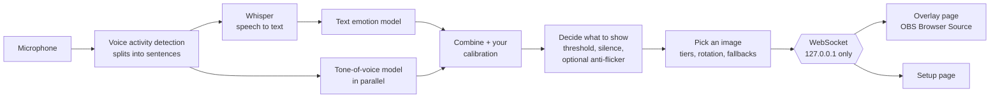

# Emotion Overlay

Emotion Overlay listens to your microphone, works out the emotion in what you're saying, and shows an image you picked for that emotion. It's built for streamers: add one URL to OBS as a Browser Source, and your on-screen image reacts to you, with no webcam and no hotkeys needed.

Everything runs on your own PC. Your audio never leaves it.

- Recognises **7 emotions**: anger, disgust, fear, joy, neutral, sadness and surprise.
- Reads both **what you say** (speech-to-text, then a text emotion model) and **how you say it** (a tone-of-voice model), then combines them.
- Reacts in about **0.55 s** after you stop talking on an NVIDIA GPU, or about **0.8 s** on a CPU. AMD Radeon GPUs are supported too, but **AMD support hasn't been tested on a real AMD card yet**. During long sentences it can change before you pause.
- Runs on **Windows** and **Linux**: see the [Windows](INSTALL-Windows.md) and [Linux](INSTALL-Linux.md) installation guides.
- Your own images and GIFs, effects, word triggers ("gg", "bruh"), slang, hotkeys, OBS scene and filter switching, live settings and per-voice calibration, all set up in a local web page.

## Contents

- [Beginner's guide](#beginners-guide)
- [Features](#features)
- [Requirements](#requirements)
- [Install and start](#install-and-start)
- [Quick start](#quick-start)
- [Add the overlay to OBS](#add-the-overlay-to-obs)
- [The setup page](#the-setup-page)
- [Hotkeys and Stream Deck](#hotkeys-and-stream-deck)
- [OBS scenes and filters](#obs-scenes-and-filters)
- [Configuration file](#configuration-file)
- [Command-line options](#command-line-options)
- [How it works](#how-it-works)
- [Accuracy and speed](#accuracy-and-speed) (emotion, speech-to-text, speed)
- [Privacy](#privacy)
- [Security](#security)
- [Troubleshooting](#troubleshooting)
- [Known limitations](#known-limitations)
- [Project layout](#project-layout)
- [Credits](#credits)
- [License](#license)

## Beginner's guide

New to this kind of thing? This part walks you through everything with no technical knowledge needed. It's written for Windows 10 and 11. On Linux, follow the [Linux installation guide](INSTALL-Linux.md) instead of Steps 1 and 2, then continue here from Step 3. The rest of this page goes into more detail, but you don't need to read it to get started.

### What it does, in one sentence

You pick a picture for each mood (happy, sad, angry and so on), and while you talk, the app works out how you sound and shows the matching picture on your stream.

### Before you start

You'll need:

- A Windows PC.
- A microphone.
- About 3.5 GB of free disk space (about 7 GB to use an NVIDIA graphics card, 10 GB or more for an AMD one).
- An internet connection for the first start only (the app downloads its "brain" once, about 2 GB).
- [OBS Studio](https://obsproject.com/) if you want the pictures on your stream. You can also just watch them in your web browser.
- Some pictures or GIFs of yourself, your character or anything you like, one or more for each mood.

### Step 1: Download the app

1. At the top of this GitHub page, click the green **Code** button, then **Download ZIP**.
2. Find the downloaded file (usually in your **Downloads** folder), right-click it and choose **Extract All…**, then click **Extract**.
3. You now have a normal folder. Put it somewhere you'll find again, like your Desktop or Documents.

### Step 2: Start it

1. Open the folder and double-click **`run-cpu.bat`**. If you have a gaming graphics card, you can use **`run-gpu.bat`** (NVIDIA) or **`run-amd.bat`** (AMD Radeon RX 7000 or 9000 series; not yet tested on a real AMD card) instead. They react faster and understand speech better, but their first start downloads several GB more. The [Windows installation guide](INSTALL-Windows.md) helps you choose.
2. If Windows shows a blue "Windows protected your PC" box, click **More info**, then **Run anyway**.
3. A black window opens with text scrolling by. **The very first time, this takes several minutes** while the app installs what it needs. Later starts take a few seconds.
4. When the black window shows a line like `Setup page: http://127.0.0.1:8765/setup`, go on to Step 3.

Keep the black window open the whole time you use the app. Closing it turns the app off.

### Step 3: Open the setup page

Open your web browser (Chrome, Edge, Firefox…), type **`127.0.0.1:8765/setup`** in the address bar and press Enter. This page is where you control everything. It only exists on your own PC. Nobody else can see it.

The first time, the app is still downloading its speech and emotion models in the background. The bar at the top of the page says **Loading…** until it's done, which can take a while on a slow connection. You can already add your pictures (Step 5) while you wait.

### Step 4: Choose your microphone

In the **Microphone** box, pick the mic you talk into from the list and click **Use this mic**. Say something. In the **Live** box, the grey dot should turn on and say **Speaking**, and a moment later your words appear under **Last transcript**.

### Step 5: Add your pictures

In the **Images** box there's a square for each mood.

1. Click **Add** on a square and choose picture files from your PC. You can also drag files onto a square, or click **Link** and paste a GIF link from a site like Giphy or Tenor.
2. Add at least one picture to **Neutral**: that's your "normal" face, shown when you're calm or quiet.
3. Click the ★ star under your favourite picture to make it the **default**. It's shown for any mood you haven't given a picture yet.

You don't have to fill every mood. Start with neutral and joy, and add more whenever you like.

### Step 6: Put it on your stream (OBS)

1. In OBS, under **Sources**, click **+** and choose **Browser**. Give it a name and click **OK**.
2. In the **URL** box, type `http://127.0.0.1:8765/overlay`.
3. Set **Width** and **Height** to the size of your pictures (for example 800 and 800), then click **OK**.
4. Drag and resize it on your scene like any other source.

The background is see-through, so only your picture shows. If you don't use OBS, open `127.0.0.1:8765/overlay` in a browser tab to watch it.

### Step 7: Talk!

Just talk normally. About a second after you finish a sentence, the picture changes to match your mood. Say "this is amazing, I love it!" and you should see your joy picture. The **Live** box on the setup page shows what it heard and how sure it was.

### Optional extras

None of these are needed, but they make it better:

- **Calibration (recommended, about 2 minutes):** in the **Calibration** box, click **Start** and read the 14 short lines out loud in the mood shown. The app learns how *your* voice sounds and suggests settings for you. Tick the ones you want and save.
- **Word triggers:** show a special picture for a few seconds when you say a certain word, like "gg" or "let's go". In the **Word triggers** box, type the word, choose a picture and click **Add trigger**.
- **Hotkeys:** keyboard shortcuts that work even while you're in a game. By default, **Ctrl+Alt+Shift+1** to **7** lock a mood on screen and **Ctrl+Alt+Shift+0** goes back to normal. In the **Hotkeys** box you can change the keys (click them, then press new ones) and make any key show any picture.
- **Settings:** change how pictures fade in, how quickly the app reacts, and more. Each setting has a short explanation, and **Reset to defaults** undoes everything.
- **Backup:** **Export setup** saves all your pictures and settings in one file, so you can move them to another PC or keep a copy.

### Using it again next time

Double-click the same launcher (`run-cpu.bat`, `run-gpu.bat` or `run-amd.bat`) again and wait for the setup page line. Your pictures and settings are remembered. OBS reconnects by itself once the app is running.

### If something isn't working

- **The picture never changes:** check that the **Live** box says **Speaking** when you talk. If not, pick a different mic in Step 4. Also check the **Stop listening** button at the top: if it says **Start listening**, click it.
- **OBS shows nothing:** make sure the black window is still open, and that the mood has a picture (or you've set a ★ default). In OBS, right-click the source and choose **Refresh**.
- **It picks the wrong mood:** do the calibration. Speaking a bit more expressively helps too, since the app listens to both your words and your tone.
- **"An Application Control policy has blocked this file":** this is Windows' Smart App Control; see [Troubleshooting](#troubleshooting).
- **The black window shows an error and stops:** take a screenshot of it. The [Troubleshooting](#troubleshooting) section covers the common ones.

## Features

- **Words and tone of voice.** A text model reads what you say, and a second model listens to how you say it. Their scores are combined with a weight you control, so a sarcastic "great" or a laugh can count.
- **Your images and GIFs.** Add several per emotion, shown at random or in a cycle. Optional **Mild** and **Strong** versions are picked by how confident the detection is. Add files, paste a link (direct, Tenor or Giphy), or drag a GIF in from another browser tab. GIFs restart from their first frame each time they appear.
- **Fallbacks.** An emotion with no images can borrow another emotion's images, or show your default image.
- **Word triggers.** Say "gg" or "let's go" and a chosen image or GIF shows for a few seconds, then the emotion image comes back. Each trigger can list alternative spellings and has a Test button for checking it in OBS.
- **Slang.** Triggers forgive how speech-to-text spells things: "sup" fires on "Wassup", "bruh" on "Bruhhhh", and "lol" on "L-O-L". Slang is also read as plain English before emotion scoring, so "lol" counts as "haha" and "that was fire" as "that was amazing". Without this the text model, trained on ordinary English, reads "lol" as neutral and "no cap that was fire" as anger.
- **Updates while you talk.** During long sentences, the words so far are re-checked as you go (every 0.5 s of speech on a GPU, every 1 s on a CPU), so the image can change before you pause.
- **Hotkeys you choose.** Global hotkeys work while a game has focus. Pick any key combination and what it does: hold an emotion, show any image (a word-trigger image or any other) until you press it again or for a few seconds, fire a word trigger, or go back to automatic. The setup page has buttons for holding emotions too, and a Stream Deck can do the same over HTTP.
- **Calibration that adapts to you.** Read 14 short lines. The app learns how your voice and mic sound and profiles how you speak (pauses, volume against background noise, expressiveness). It then tests whether tone of voice helps for you and recommends settings, each with its reason. You choose which to apply.
- **CPU or GPU.** Choose where the models run on the setup page. Switching takes effect while the app runs. GPU support (NVIDIA, or AMD Radeon, which is untested so far) is an optional install.
- **Live settings.** Every display and detection setting can be changed on the setup page while you stream. Changes apply immediately and are saved.
- **Responsive by default.** The image follows every sentence. Optional anti-flicker controls (smoothing, a hold-off before switching, a minimum time on screen) give a calmer overlay if you want one.
- **Transitions and effects.** Cross-fade, cut or bounce between images, plus an optional effect per emotion when its image appears: shake, pulse, jump, tremble or droop.
- **OBS scenes and filters.** The emotion can switch OBS scenes, or turn a filter on (for example a red colour correction for anger), through OBS's built-in WebSocket server.
- **Your mic is remembered by name,** so plugging in a headset or webcam doesn't switch the app to the wrong input.
- **Stop/Start listening.** Pausing closes the microphone completely, so your system's mic-in-use indicator goes off, and the overlay shows your neutral image.
- **Backup.** Export your whole setup (images, triggers and settings) as one zip, and import it on another PC or share it.

## Requirements

- **Windows 10 or 11**, or **Linux** (64-bit, x86-64). It's developed on Windows. On Linux, the CPU and NVIDIA versions have been tested on Ubuntu 26.04, and everything except the global hotkeys works. macOS hasn't been tested.
- **A microphone.** A dedicated input works best: "Stereo Mix" or a desktop-audio device would pick up game audio too.
- **Disk space:** about 3.5 GB, or about 7 GB with NVIDIA GPU support and 10 GB or more with AMD GPU support. Most of this is the models, downloaded on first start.
- **Optional: a graphics card,** which makes the app react faster and lets it use a more accurate speech-to-text model. About 4 GB of video memory is enough.
  - **NVIDIA:** GTX 10 series or newer, with driver version 580 or newer.
  - **AMD:** Radeon RX 7000 or 9000 series. On Windows this needs AMD Software: Adrenalin Edition 26.2.2 or newer. On Linux, any GPU that ROCm 7.2 supports works. AMD support is new and hasn't been tested on AMD hardware yet.

Python 3.11 or newer and [uv](https://docs.astral.sh/uv/) are used, but you don't need to install them first. The Windows launchers install uv, and uv installs Python.

## Install and start

Step-by-step guides, including updating and uninstalling:

- **[Windows installation guide](INSTALL-Windows.md)**: download, then double-click `run-cpu.bat`, `run-gpu.bat` (NVIDIA) or `run-amd.bat` (AMD, untested).
- **[Linux installation guide](INSTALL-Linux.md)**: install PortAudio and uv, then run `uv sync` and `uv run`.

In short, with [uv](https://docs.astral.sh/uv/getting-started/installation/) installed, in the app's folder:

```sh
uv sync && uv run python -m emotion_overlay                               # CPU (Windows)
uv sync --extra cpu && uv run --extra cpu python -m emotion_overlay       # CPU (Linux)
uv sync --extra gpu && uv run --extra gpu python -m emotion_overlay       # NVIDIA GPU
uv sync --extra amd && uv run --extra amd python -m emotion_overlay       # AMD GPU, Linux only (untested)
```

Keep the same `--extra` option on every `uv run`, or uv swaps in a different build of PyTorch. On Linux, a plain `uv sync` installs PyPI's PyTorch, which bundles NVIDIA's libraries (about 4 GB more), so use `--extra cpu` there. The first start downloads the models: about 2 GB, plus about 1.6 GB for the larger speech-to-text model (`large-v3-turbo`) the first time a GPU is used. After that the app starts offline.

## Quick start

1. Start the app and open **http://127.0.0.1:8765/setup** (the console prints this address).
2. **Microphone:** pick the mic you talk into and click **Use this mic**.
3. **Processor:** choose **Automatic (GPU if available)**. It uses the GPU when GPU support is installed and the CPU otherwise.
4. **Images:** add at least one image per emotion you care about, plus one for neutral. Click ★ on an image to make it the default, which is shown for emotions that have no images of their own.
5. **Calibration:** click **Start**, read the 14 lines as prompted, then apply the recommended settings you agree with.
6. Add the overlay to OBS (below) and talk. The **Live** panel shows what was heard, the scores, and how long each step took.

## Add the overlay to OBS

1. **Sources → + → Browser**.
2. URL: `http://127.0.0.1:8765/overlay`. Set the width and height to your image size (for example 800 × 800).
3. Leave custom CSS empty. The page background is already transparent.

URL options:

| Option | Effect |
|---|---|
| `?fit=cover` | Fill the source and crop, instead of fitting the whole image with empty borders |
| `?label=1` | Show the emotion's name on the overlay (handy for testing) |

Combine them with `&`, for example `http://127.0.0.1:8765/overlay?fit=cover&label=1`.

The overlay only ever receives "show this image". Transcripts and scores never reach it.

## The setup page

The setup page is at **http://127.0.0.1:8765/setup**. Everything on it applies immediately and is saved.

### Microphone

Pick an input and click **Use this mic**. The mic is remembered by name (and audio system), so plugging devices in or out doesn't change which one is used. If the saved mic isn't connected, the page says so and the system default is used until it's back. The **Stop listening** button at the top of the page turns the microphone off completely.

### Processor

Choose **Automatic (GPU if available)**, **GPU** or **CPU**. GPU means an NVIDIA card, or an AMD card when started with `run-amd.bat` or `--extra amd` (AMD is untested so far). The card shows which GPU was found (or why the GPU can't be used) and where each model is running right now. Switching loads the models on the new device in the background, and the current models keep handling your speech until the new ones are ready. Switching isn't possible during the first few seconds after starting, while the models are still loading.

### Live

This panel shows the current emotion and image, whether you're speaking, the last transcript, the text the emotion model read, the scores for each emotion, the tone of voice result, and timings for each step.

**Hold an emotion** keeps an emotion on screen until you click **Automatic**. Detection keeps running underneath, so the right image is back as soon as you release it. A word trigger still shows over a held emotion.

### Images

- Upload PNG, JPEG, WebP or GIF files (up to 10 MB and 4096 × 4096 pixels each), paste a link, or drag an image in from another browser tab. Tenor and Giphy page links work too.
- Give each image an emotion, or the **trigger** group for images only word triggers use.
- **Tier:** **Any**, **Mild** or **Strong**. Strong images show when the detection is confident (at or above the Strong-tier threshold), and Mild ones below it. When an emotion has no image of the needed tier, its **Any** images are used, and if there are none, whatever it has.
- **★ Default:** shown for any emotion without images of its own.
- Rename images. The name is only for you; files are stored under random IDs.

### Word triggers

Each trigger has one or more phrases, an image, and a duration (0.5–60 s). When you say a phrase, the image shows for that long, then the emotion image comes back. Matching is whole-word and ignores case, punctuation and apostrophes ("G.G." matches "gg", "whats" matches "what's"). Stretched letters match too ("bruh" fires on "bruhhhh"), as do common slang spellings. Up to 50 triggers. **Test** shows a trigger without saying it.

### Settings

| Setting | Default | What it does |
|---|---|---|
| **Display** | | |
| Transition | Cross-fade | Cross-fade, cut or bounce between images |
| Transition time | 300 ms | Length of the transition |
| With several images | Pick randomly | Pick randomly (never the same twice in a row) or cycle in order |
| New image every sentence | Off | Switch to another image of the same emotion each time you speak |
| Strong-tier threshold | 0.85 | Strong images show at or above this confidence |
| **Detection** | | |
| Minimum confidence | 0.5 | Below this, the detection counts as unsure |
| When unsure | Keep current image | Keep the current image, or go to neutral |
| Back to neutral after silence | 3 s | Show neutral after this much silence |
| Text window | 6 s | How much recent speech is judged together. 0 = only the last sentence |
| Update while talking | Automatic | Re-check your words while you're still talking: every 0.5 s on a GPU, every 1 s on a CPU, a fixed interval, or off |
| Understand slang | On | Read slang as plain English before judging the emotion |
| Pause that ends a sentence | 400 ms | Shorter reacts faster but may split sentences |
| Longest chunk of speech | 6 s | Non-stop talking is judged in chunks this long |
| Voice detection threshold | 0.5 | Higher ignores more background noise |
| **Tone of voice** | | |
| Use tone of voice | On | Turn the voice model on or off |
| Voice weight | 0.25 | How much the voice counts against the words. 0 = words only, 1 = voice only |
| **Stability (anti-flicker)** | | All off by default, so the image follows every sentence |
| Smoothing | 1 (off) | Lower values average each new result with the previous ones |
| Sentences before switching | 1 (off) | A new emotion must stay on top this many times in a row before it shows |
| Instant-switch lead | 0 (off) | A new emotion that leads by this much switches at once anyway |
| Minimum time on screen | 0 s (off) | Keep each emotion at least this long |
| **Emotions without images** | Default image | For each emotion, what to show when it has no images: the default image, or another emotion's images |
| **Effects** | None | For each emotion, an animation the overlay plays when its image appears: shake, pulse, jump, tremble or droop |

**Reset to defaults** restores all of these. The microphone, images, triggers and calibration are not affected.

### Calibration

Calibration takes about two minutes. Click **Start calibration** and read the 14 short lines, two per emotion, in the way each one asks (for example "Say it happy" or "Say it scared"). Then the app:

- **Corrects the models for your voice and mic.** For example, if the voice model hears you as a bit angry all the time, that's undone. It reports how often the words, the voice and the combination were right, before and after calibrating.
- **Recommends settings for how you speak,** each with its reason. It measures your pauses (pause that ends a sentence), your speech against your background noise (voice detection threshold), whether tone of voice helps for your voice (voice weight), and how confidently your lines were recognised (minimum confidence and Strong-tier threshold). You tick the ones to apply.

Recalibrate if you change microphones, rooms, or the voice model. A calibration made for a different voice model is switched off automatically.

### Backup

**Export setup** saves your images, word triggers and the settings from the Settings card as one zip. **Import setup…** replaces everything currently set up with a zip's contents, after checking all of it first. Calibration isn't included, because it's tuned to one voice and mic.

## Hotkeys and Stream Deck

Global hotkeys work while another app (such as a game) has focus. Set them up in the **Hotkeys** card on the setup page; changes apply right away.

- **Keys:** click a hotkey's key combination, then press the new keys. Combinations need Ctrl, Alt or Win, so they can't block normal typing. F1–F24, Pause and Scroll Lock also work on their own, which suits a Stream Deck or macro pad (many can send F13–F24). **Add hotkey** asks for the keys first.
- **What it does:**
  - **Hold an emotion:** shows that emotion's images until you press the same keys again or a "Back to automatic" key.
  - **Show an image:** any image you've added, including the ones in **Word triggers only**. Either *until pressed again* (held like an emotion) or *for a few seconds* (like a word trigger).
  - **Fire a word trigger:** as if you'd said its phrase.
  - **Back to automatic:** lets go of a held emotion or image.
- **Test** does what the hotkey does without pressing it. **Reset to defaults** brings back the defaults below. **Hotkeys on** turns them all off or on.
- **Deleted images or triggers:** the hotkey stays, and the setup page says it's not working until you pick something else.
- **Conflicts:** if another app already uses a combination, the setup page says so on that hotkey.
- **Platforms:** hotkeys are Windows only. Elsewhere, use the setup page or the API.
- **Not in backups:** like the OBS settings, hotkeys stay on this PC.

The defaults:

| Keys | Holds |
|---|---|
| Ctrl+Alt+Shift + 1 | anger |
| Ctrl+Alt+Shift + 2 | disgust |
| Ctrl+Alt+Shift + 3 | fear |
| Ctrl+Alt+Shift + 4 | joy |
| Ctrl+Alt+Shift + 5 | neutral |
| Ctrl+Alt+Shift + 6 | sadness |
| Ctrl+Alt+Shift + 7 | surprise |
| Ctrl+Alt+Shift + 0, or the same key again | back to automatic |

They use three modifiers because on many keyboard layouts Ctrl+Alt acts as AltGr, and AltGr + a digit types a character.

A **Stream Deck** (or any tool that can send HTTP requests) can control the same thing:

```sh
curl -X PUT http://127.0.0.1:8765/api/manual -H "Content-Type: application/json" -d "{\"emotion\": \"joy\"}"
curl -X PUT http://127.0.0.1:8765/api/manual -H "Content-Type: application/json" -d "{\"emotion\": null}"
```

The first holds joy; the second goes back to automatic. `{"image_id": "<id>"}` holds one image instead (image IDs are in `GET /api/images`). Other useful endpoints:

| Request | Effect |
|---|---|
| `PUT /api/listening` with `{"listening": false}` or `true` | Stop or start listening |
| `POST /api/triggers/<id>/test` | Show a word trigger's image |
| `POST /api/hotkeys/<n>/press` | Do what hotkey number `n` (from 0, in the setup page's order) does |
| `PUT /api/compute` with `{"device": "auto"}`, `"cuda"` or `"cpu"` | Choose the processor |
| `GET /api/status` | Current emotion, image and engine status |

Requests from web pages on other sites are refused (see [Security](#security)). Tools like a Stream Deck aren't web pages, so they work.

## OBS scenes and filters

The emotion can also control OBS itself: switch to a scene, and/or turn on a filter, for each emotion. This uses the WebSocket server built into OBS 28 and newer.

1. In OBS: **Tools → WebSocket Server Settings**, tick **Enable WebSocket server**, and click **Show Connect Info** to see the port and password.
2. On the setup page, in **OBS scenes and filters**: tick **Connect to OBS**, enter the port (usually 4455) and password, and click **Save**. The status line says when it's connected.
3. For each emotion, pick a scene to switch to, or leave it at "Don't switch".
4. For filters: add the filters you want to a source in OBS first (for example a **Color Correction** filter called "Angry red" on your overlay's Browser source, turned off). Then choose that source under **Toggle filters on**, and pick a filter for each emotion. When an emotion starts showing, its filter is turned on and the other emotions' filters on that source are turned off.

OBS follows the emotion the overlay shows, including one you hold by hand, but not word triggers. A scene or filter that was renamed or removed in OBS is reported in the status line without disconnecting. If OBS isn't running, the app keeps retrying every few seconds.

The OBS address and password are saved in `config.yaml` on your PC only. They're never sent to the setup page, and they're left out of backups, so an imported setup can't make the app connect somewhere else.

## Configuration file

Settings are saved in `config.yaml` in the project folder. The setup page writes it, so you rarely need to edit it. Every key is optional; missing ones use their defaults. A few settings can only be changed here, and need a restart: the models, devices other than via the Processor card, the server address, upload limits and debug recording. Hotkeys and OBS settings have their own cards on the setup page.

These are all the settings, with their defaults:

```yaml
audio:
  device: null              # input device index (older setting); the name below takes precedence
  device_name: null         # saved microphone, set by "Use this mic"
  device_hostapi: null      # its audio system (e.g. Windows WASAPI, MME)

vad:                        # voice activity detection (Silero VAD)
  threshold: 0.5            # speech probability needed to count as speech (0.05-0.95)
  min_silence_ms: 400       # pause that ends a sentence
  speech_pad_ms: 150        # audio kept before and after speech
  min_utterance_ms: 250     # shorter sounds are ignored
  max_utterance_s: 6.0      # non-stop speech is cut into chunks this long

asr:                        # speech-to-text (Whisper)
  backend: auto             # auto | faster-whisper | transformers
  model: base.en            # used on the CPU; small.en is more accurate but ~3x slower
  gpu_model: large-v3-turbo # used when speech-to-text runs on the GPU
  device: auto              # auto | cuda | cpu; cuda means any GPU, AMD too (the Processor card sets all three)
  compute_type: int8        # faster-whisper precision
  language: en
  beam_size: 1              # higher is slower and slightly more accurate
  no_speech_threshold: 0.6  # drop text Whisper thinks is noise ("you", "Thank you.")

classifier:                 # emotion from the words
  model: j-hartmann/emotion-english-distilroberta-base
  device: auto
  window_seconds: 6.0       # judge the last N seconds of speech together; 0 = last sentence only
  slang: true               # read slang as plain English first
  interim_s: null           # re-check while still talking every N s of speech; 0 = off; null = automatic

audio_emotion:              # emotion from tone of voice
  enabled: true
  model: tiantiaf/wavlm-large-categorical-emotion
  device: auto
  weight: 0.25              # voice share of the combined score; 0 = words only
  label_map:                # voice model label -> emotions it stands for; other labels are ignored
    anger: [anger]
    disgust: [disgust]
    fear: [fear]
    happiness: [joy]
    neutral: [neutral]
    sadness: [sadness]
    surprise: [surprise]

state:                      # what is shown (see "Settings" above)
  confidence_threshold: 0.5
  low_confidence: hold      # hold | neutral
  silence_timeout_s: 3.0
  smoothing: 1.0            # 1 = off
  persist_windows: 1        # 1 = off
  instant_switch_margin: 0.0
  min_display_s: 0.0

display:
  transition: fade          # fade | cut | bounce
  fade_ms: 300
  rotation: random          # random | cycle
  new_image_each_utterance: false
  strong_threshold: 0.85
  fallbacks: {}             # e.g. {disgust: anger}: show anger's images for disgust if it has none
  effects: {}               # e.g. {anger: shake, joy: pulse}; also shake, jump, tremble, droop

uploads:
  max_bytes: 10485760       # 10 MB per image
  max_pixels: 16777216      # 4096 x 4096
  max_import_bytes: 209715200   # 200 MB per backup zip

server:
  host: 127.0.0.1           # keep on localhost; nothing here is meant to be reachable from a network
  port: 8765

hotkeys:                    # Windows only; edited in the Hotkeys card, not in backups
  enabled: true
  bindings:                 # defaults: ctrl+alt+shift + 0 (automatic) and + 1..7 (the emotions)
  - keys: ctrl+alt+shift+0  # modifiers (ctrl, alt, shift, win) then one key, joined with +
    action: auto            # auto, emotion, image or trigger
  - keys: ctrl+alt+shift+1
    action: emotion
    emotion: anger
  # ... + 2..7 for disgust, fear, joy, neutral, sadness, surprise. Other kinds:
  # - keys: f13
  #   action: image
  #   image_id: <id>        # any image; see GET /api/images
  #   duration_s: null      # null = until pressed again, or 0.5-60 seconds
  # - keys: ctrl+alt+g
  #   action: trigger
  #   trigger_id: <id>      # a word trigger; see GET /api/triggers

obs:                        # OBS remote control (see "OBS scenes and filters"); not in backups
  enabled: false
  host: 127.0.0.1
  port: 4455
  password: ""              # stored here only; never sent to the setup page
  scenes: {}                # e.g. {anger: Rage scene}
  filter_source: ""         # source whose filters are toggled
  filters: {}               # e.g. {anger: Angry red}

debug:                      # privacy: both off; nothing is written to disk unless enabled
  save_audio: false         # save each sentence as a WAV in data/debug/
  save_transcripts: false   # append transcripts to data/debug/transcripts.log

data_dir: data              # images, triggers, calibration
```

**Other voice models:** any Hugging Face audio-classification model can be used as `audio_emotion.model`. Its labels must then be mapped in `label_map`. One label may stand for several emotions; for example, a 4-mood model might use `ang: [anger, disgust, fear]`. The voice's probability is then shared between those emotions in proportion to the text scores. Each emotion may appear only once.

## Command-line options

| Option | Purpose |
|---|---|
| `--config PATH` | Use another config file (default `config.yaml`) |
| `--no-audio` | Serve the web pages only, without loading models or opening the microphone |
| `--open-browser` / `--no-open-browser` | Open the setup page on start (off by default) |
| `--self-test` | Load every model, run each once without a microphone, then exit. A good first check if something doesn't work |
| `--log-level DEBUG` | Verbose logs, including transcripts and any network requests |

The Windows launchers pass options on, for example `run-gpu.bat --self-test`.

## How it works



1. **Splitting speech into sentences.** [Silero VAD](https://github.com/snakers4/silero-vad) scores each 32 ms of audio for speech. A sentence ends after a 400 ms pause, and non-stop speech is cut every 6 s. While a sentence is still going, the part so far is re-checked (words only) every 0.5 s of speech on a GPU or every 1 s on a CPU.
2. **Speech-to-text.** Whisper `base.en` runs through [faster-whisper](https://github.com/SYSTRAN/faster-whisper) on the CPU. On a GPU the much larger and more accurate `large-v3-turbo` runs instead, taking about 110 ms per sentence there (on a CPU it would take about 5 s). On a GPU it runs through faster-whisper if NVIDIA's CUDA 12 libraries are installed, and otherwise through 🤗 transformers, which is always the case on AMD cards. Transformers is also the fallback when Windows blocks faster-whisper's native library. Either way, text Whisper thinks is noise is dropped; Whisper otherwise "hears" words like "you" in silence.
3. **Emotion from the words.** [`j-hartmann/emotion-english-distilroberta-base`](https://huggingface.co/j-hartmann/emotion-english-distilroberta-base) scores the last ~6 s of transcript, after slang is rewritten as plain English.
4. **Emotion from the voice.** [`tiantiaf/wavlm-large-categorical-emotion`](https://huggingface.co/tiantiaf/wavlm-large-categorical-emotion) from [Vox-Profile](https://arxiv.org/abs/2505.14648) is a WavLM-large model trained on MSP-Podcast, which is natural podcast speech rather than actors. It's a simplified, audio-only version of the top system in the INTERSPEECH 2025 speech emotion challenge. It was published for the authors' own code rather than as a standard transformers model, so `classify/vox_profile.py` rebuilds its small inference path and loads the weights directly. It runs on the same audio at the same time as Whisper. If it's still busy when the words are scored, the words-only result is shown first and then refined, so it never delays the first reaction.
5. **Combining.** `final = (1 − w) · words + w · voice`, with `w = 0.25` by default. Calibration adds two small sets of per-emotion corrections in log space: one undoes a skew in the voice model for your voice and mic, and one adjusts the combined result.
6. **Deciding what to show** (`state_machine.py`, pure and unit-tested). The top emotion is shown if it clears the minimum confidence. Silence returns to neutral. The optional anti-flicker rules (smoothing, a hold-off, a lead that switches instantly, a minimum display time) are off by default, so the image follows every sentence.
7. **Showing it.** The image picker applies tiers, rotation and fallbacks, and the server sends the result over a WebSocket to the overlay page in OBS, which plays the emotion's effect if it has one. If OBS control is on, OBS switches scene or filters too.

The server is FastAPI on `127.0.0.1:8765`. The web pages are plain JavaScript and CSS, with no build step.

## Accuracy and speed

### Accuracy on acted speech

The models were evaluated on [RAVDESS](https://zenodo.org/records/1188976): 1,440 clips from 24 actors. **Every clip is one of two emotionally neutral sentences** ("Kids are talking by the door"), each said in 8 emotions ("calm" counts as neutral). That isolates what the *voice* contributes, because the words carry no emotion. Chance is 14.3%.

| Mode | Accuracy | Macro-F1 |
|---|---|---|
| Always say "neutral" | 20.0% | — |
| Words only | 21.9% | 7.9% |
| Voice only | **40.1%** | **35.5%** |
| Combined, default voice weight (0.25) | 22.5% | 9.0% |
| Combined + per-speaker calibration (0.25) | 25.8% | 13.1% |
| *Previous voice model (`superb/hubert-base-superb-er`), voice only* | *21.4%* | *11.9%* |

- **The voice model transfers to unseen actors.** Trained only on podcast speech, it gets 40% across 7 emotions, nearly double the previous model. It's best at anger (79% recall), fear (70%), neutral (48%) and surprise (38%). It mostly misses acted joy (7%) and disgust (2%), so the words do the work for those.
- **At the default weight, the words dominate.** A confident "neutral" from the words outweighs the voice here, because these sentences are neutral by design. In normal speech the words usually carry the emotion, which is why the default stays at 0.25. Calibration measures this for your own voice and recommends a weight.
- **Calibration helps the voice most.** Fitting on 2 clips per emotion per speaker and testing on the rest takes the voice alone from 40% to 44%.
- **Acted speech isn't streaming.** Actors exaggerate far more than people talking naturally, so these numbers say little about how often it's right on stream. That depends mostly on the words.

### Speech-to-text accuracy

The emotion from your words can only be as good as the transcript. The table shows the share of words each Whisper model got wrong (word error rate; lower is better) on four kinds of speech, measured on an RTX 5070 and a 16-thread Ryzen CPU:

| Speech | `base.en`, CPU (CPU default) | `small.en`, CPU | `large-v3-turbo`, GPU (GPU default) |
|---|---|---|---|
| One person reading clearly (28 lines) | 2.0% | 1.0% | 1.0% |
| Indian-accented English ([Svarah](https://huggingface.co/datasets/ai4bharat/Svarah), 1,000 clips, 117 speakers) | 12.7% | 9.9% | 7.4% |
| Unscripted meetings, headset mic ([AMI](https://huggingface.co/datasets/edinburghcstr/ami), 504 clips) | 17.1% | 15.9% | 15.1% |
| The 28 read lines, with 3 people talking 5 dB quieter in the background | 37.0% | 21.0% | 12.5% |
| Meetings, one microphone on the table, people talking over each other (AMI, 634 clips) | 41.6% | 36.3% | 34.1% |
| **Time per sentence** | **~0.4 s** | **~1.2 s** | **~0.1 s** |

- **The GPU model is the most accurate and also the fastest.** Its advantage is biggest where it matters on stream: accents, and other voices in the background.
- **On a CPU, `small.en` is a middle ground.** It makes about a fifth fewer mistakes than `base.en` with accents, and about 40% fewer with background voices, but each sentence takes about 0.8 s longer. To use it, set `asr.model: small.en` in `config.yaml`.
- **Crosstalk is hard for every model.** With background voices as loud as yours, all of them get about half the words or more wrong, and some transcribe the other voices instead of yours. A headset or a directional mic close to your mouth helps more than any model.
- **Not every mistake is a real mishearing.** Some come from writing styles ("70 %" against "70%") or from errors in the reference transcripts. These affect every model equally, so the comparison is fair, but the true error rates are a bit lower.

### Speed

Measured from the end of a sentence to the new emotion being decided. On top of this come the overlay's transition (300 ms by default) and OBS.

| | Pause that ends a sentence | Speech-to-text | Voice model | Total (median) |
|---|---|---|---|---|
| CPU (16-thread Ryzen) | 400 ms | ~300–400 ms | ~500–850 ms, in parallel | ~0.7–0.8 s first reaction, ~0.8–1.3 s with voice |
| GPU (RTX 5070) | 400 ms | ~110 ms (`large-v3-turbo`) | ~30–50 ms, in parallel | ~0.55 s |

On the CPU the words-only result appears first, and the tone-of-voice result follows. On the GPU both arrive together. On a GPU the models use about 3.5 GB of video memory. During long sentences, **Update while talking** reacts before you pause.

## Privacy

- **Audio stays in memory.** Sentences are processed and discarded. Nothing is written to disk unless you turn on `debug.save_audio` or `debug.save_transcripts`.
- **Transcripts aren't logged** at the default log level. Only timings and the detected emotion are.
- **No network after the first start,** except when you add an image from a link (only that link is fetched). Models load from the local cache, and Hugging Face is contacted only if a model is missing. Telemetry is turned off. To check, run with `--log-level DEBUG` and look for HTTP requests.
- **Hotkeys don't watch your keyboard.** They're registered with Windows' `RegisterHotKey`, which only reports the app's own key combinations. There's no keyboard hook. Turn them off with **Hotkeys on** on the setup page.
- **The overlay never receives transcripts.** Only the setup page gets them.
- **Calibration keeps only numbers.** `data/calibration.json` holds fitted corrections and accuracy figures, not your recordings or words. It's left out of backups.
- **OBS control is off unless you turn it on.** Then the app connects only to the OBS address you enter, and sends only scene and filter changes. The OBS password is kept in `config.yaml` and never sent to the setup page.
- **Your files stay local.** `config.yaml` and `data/` (images, triggers, calibration) are in the project folder and are excluded from git.
- **Installing GPU support downloads from the vendor.** `run-gpu.bat` and `--extra gpu` get PyTorch from pytorch.org. `run-amd.bat` gets it from AMD (repo.radeon.com), and `--extra amd` from pytorch.org. Nothing about you is sent.

## Security

The server only listens on `127.0.0.1`, so other computers can't reach it. Web pages open in your own browser can still send requests to localhost, so the server also defends against those:

| Threat | Protection |
|---|---|
| A website reads your live transcript over the WebSocket | WebSocket connections from any other origin are refused |
| A website uploads, deletes or changes settings | `POST`/`PUT`/`DELETE` requests from another origin get 403 |
| DNS rebinding | Requests whose `Host` header isn't localhost get 400 |
| A malicious upload (script, SVG, polyglot, decompression bomb) | The type is decided by parsing the content with Pillow, limited to PNG/JPEG/WebP/GIF, with size and pixel limits. Served with a fixed type and `nosniff` |
| Path traversal through a file name or ID | Files are stored under random IDs. Upload file names are display-only. IDs are validated and looked up, never used as paths |
| Script injection through file names or transcripts | The pages never insert HTML from data. A strict Content Security Policy allows only the app's own scripts |
| A malicious backup zip (zip slip, zip bomb, disguised files) | Nothing is extracted by its path in the zip. Only expected entries are read, into memory, with limits on count and size. Every image is re-validated. Everything is checked before anything changes |
| "Add from link" used to reach your network (router, localhost, cloud metadata) | Only http/https to **public** addresses, re-checked on every redirect, with no system proxy. Size-capped, and validated like an upload |
| A shared setup that changes risky settings | Imports only apply display and detection settings. The server address, OBS connection, debug recording, models and limits are ignored |

## Troubleshooting

**Run the self-test first.** On Windows, run `run-cpu.bat --self-test` (or the same with `run-gpu.bat` or `run-amd.bat`). Anywhere, you can run `uv run python -m emotion_overlay --self-test`, adding the `--extra` option you installed with after `uv run` (for example `uv run --extra cpu ...` on Linux). It loads every model and runs each once, and names the step that fails. The installation guides for [Windows](INSTALL-Windows.md#windows-problems) and [Linux](INSTALL-Linux.md#linux-problems) cover problems specific to each system.

**"An Application Control policy has blocked this file" / Smart App Control.** Windows' Smart App Control blocks unsigned native libraries that don't have a good reputation yet, and its verdict on a file can change over time.
- If it blocks faster-whisper, the app falls back to Whisper through PyTorch automatically (`asr.backend: auto`). That's slower on the CPU, but works.
- If it blocks PyTorch itself in one environment, try the other launcher. The GPU environment's PyTorch build can also run on the CPU: choose **Processor → CPU**.
- `uv run pytest` can be blocked too; `uv run python -m pytest` works.

**GPU not available.** The Processor card says why:
- "PyTorch is CPU-only": use `run-gpu.bat` or `run-amd.bat`, or run `uv sync --extra gpu` (or `--extra amd` on Linux).
- "No NVIDIA GPU" or "No AMD GPU supported by ROCm": the driver is missing or too old, or the card isn't supported. See the installation guide for your system.

If you start the app by hand, keep the `--extra` option you installed with on every `uv run`. Without it, uv swaps in a different build of PyTorch.

**"The models are still loading" when switching processor.** Wait until the status says it's listening, then switch.

**Setup page doesn't open, or "already running".** Only one copy can run at a time. Close the other console window (or terminal), or open http://127.0.0.1:8765/setup in your browser. If port 8765 is taken by another program, set `server.port` in `config.yaml`, and use the new port in OBS too.

**"Your saved mic isn't connected".** Plug it in and click **Refresh list**, or pick another mic and click **Use this mic**.

**It reacts to game audio or background noise.** Use a dedicated mic input rather than a desktop-audio device, raise the voice detection threshold, or run calibration so it can measure your background noise.

**It mishears you when others are talking nearby.** Use a headset or a mic close to your mouth. A GPU helps a lot, because it runs a larger speech model. On a CPU, `asr.model: small.en` in `config.yaml` is more accurate than the default, at about 0.8 s more per sentence.

**The image changes too often.** Turn on one of the Stability settings, for example "Sentences before switching" = 2 or "Minimum time on screen" = 3 s.

**Hotkeys don't work.** They're Windows only. The setup page marks any combination another app already uses; click it and press different keys. Some combinations are reserved by Windows (such as Ctrl+Alt+Delete or many Win + letter keys) and can't be used.

**OBS won't connect.** Check that OBS is running, that **Enable WebSocket server** is ticked in **Tools → WebSocket Server Settings**, and that the port and password match **Show Connect Info**. "OBS refused the connection" means the password is wrong.

**The first start is slow.** It downloads about 1.8 GB of models once, plus about 1.6 GB for `large-v3-turbo` the first time the GPU is used. Later starts load them from the cache.

## Known limitations

- **English only** by default. The speech-to-text language is a setting, but the default text emotion model is English.
- **The voice model is big:** a 1.3 GB download, and about 0.85 s per sentence on a CPU (about 40 ms on a GPU). It rarely recognises acted joy or disgust; the words do the work there.
- **Calibration is small.** 14 lines can only nudge the models, not retrain them, and the recommendations are only as good as how naturally you read the lines.
- **No prebuilt installer.** It would need code signing to get past Smart App Control, so the app runs from source.
- **Hotkeys are Windows only.**
- **AMD GPU support is untested.** It has never been run on an actual AMD card. What has been checked: on Windows, `run-amd.bat` installs AMD's PyTorch build, and without an AMD card the app falls back to the CPU and passes its self-test; on Linux, the `amd` install resolves. If you have a Radeon card, please report whether it works.
- **Speech-to-text struggles with crosstalk.** With other people talking at the same time as you, Whisper makes many more mistakes, especially the small CPU model (see [Speech-to-text accuracy](#speech-to-text-accuracy)).

## Project layout

```
run-cpu.bat, run-gpu.bat,  Windows launchers: CPU, NVIDIA GPU and AMD GPU (the GPU
  run-amd.bat                ones each in their own environment)
INSTALL-Windows.md,        Installation guides
  INSTALL-Linux.md
LICENSE                    MIT licence
pyproject.toml, uv.lock    Dependencies (extras: "gpu" = PyTorch for NVIDIA, "amd" = for AMD on Linux)
src/emotion_overlay/
  main.py                  Command line and startup
  pipeline.py              Worker threads: mic -> VAD -> speech-to-text + voice -> scores -> display
  audio/                   Microphone capture, voice activity detection
  asr.py                   Whisper (faster-whisper and transformers backends)
  classify/                Text model, voice model (vox_profile.py), text window, fusion maths
  state_machine.py         Decides what is shown (pure, no I/O)
  calibration.py           Calibration prompts, fitting and storage
  personalize.py           Recommended settings from your calibration lines
  slang.py, triggers.py    Slang table and word triggers
  images.py, fetch.py      Image store and validation; safe "add from link"
  compute.py               CPU/GPU detection (NVIDIA CUDA or AMD ROCm)
  hotkeys.py               Windows global hotkeys
  obs.py                   OBS remote control (obs-websocket v5)
  settings.py, config.py   Settings that can change live; the config file
  backup.py                Export and import of your setup
  server/                  FastAPI app, WebSocket hub, image picker, security checks
  selftest.py              --self-test
web/                       Setup page and overlay page (plain JavaScript, no build step)
```

Your own files, created when you use the app: `config.yaml` (settings) and `data/` (images, triggers and calibration). Both stay on your PC.

## Credits

- Speech-to-text: [OpenAI Whisper](https://github.com/openai/whisper) (MIT), via [faster-whisper](https://github.com/SYSTRAN/faster-whisper) and [🤗 transformers](https://github.com/huggingface/transformers)
- Voice activity detection: [Silero VAD](https://github.com/snakers4/silero-vad) (MIT)
- Emotion from text: [`j-hartmann/emotion-english-distilroberta-base`](https://huggingface.co/j-hartmann/emotion-english-distilroberta-base) by Jochen Hartmann
- Emotion from voice: [`tiantiaf/wavlm-large-categorical-emotion`](https://huggingface.co/tiantiaf/wavlm-large-categorical-emotion) from Vox-Profile ([paper](https://arxiv.org/abs/2505.14648)), under the OpenRAIL licence on its model card
- Evaluation data, not included in this repository: [RAVDESS](https://zenodo.org/records/1188976), © Livingstone & Russo 2018, CC BY-NC-SA 4.0; [Svarah](https://huggingface.co/datasets/ai4bharat/Svarah) by AI4Bharat, CC BY 4.0; [AMI Meeting Corpus](https://huggingface.co/datasets/edinburghcstr/ami), CC BY 4.0
- Built with [FastAPI](https://fastapi.tiangolo.com/), [PyTorch](https://pytorch.org/), [sounddevice](https://python-sounddevice.readthedocs.io/) and [Pillow](https://python-pillow.org/)

## License

[MIT](LICENSE). The models are downloaded from Hugging Face and come with their own licences (see [Credits](#credits)).
